 

  

<h1>MULTI-MODE AUTONOMOUS SMART ROBOTIC CAR</h1>

<strong>
A FOUR-WHEEL-DRIVE ROBOTIC PLATFORM
</strong>

Wireless Teleoperation · Autonomous Navigation · Embedded Intelligence

<a href="#project-overview">PROJECT OVERVIEW</a>
&nbsp; ◆ &nbsp;
<a href="#three-operating-modes">THREE MODES</a>
&nbsp; ◆ &nbsp;
<a href="#hardware-architecture">HARDWARE</a>
&nbsp; ◆ &nbsp;
<a href="#getting-started">GET STARTED</a>

  

## 🔴🟠 ABSTRACT 🟠🔴

**PROJECT OVERVIEW · SYSTEM DESIGN · ENGINEERING PRINCIPLES**

This project presents the design, development, programming, and evaluation framework of a Multi-Mode Autonomous Smart Robot Car, a four-wheel-drive (4WD) robotic platform developed around the Arduino Uno microcontroller. The system combines embedded electronics, real-time sensing, wireless communication, motor control, and autonomous decision-making to demonstrate how an inexpensive robotic vehicle can navigate its environment and respond to external commands.

The proposed platform integrates an Arduino Uno based on the ATmega328P microcontroller, an L298N dual H-bridge motor driver, four geared DC motors, an HC-SR04 ultrasonic distance sensor, infrared (IR) line-tracking sensors, and an HC-05 Bluetooth communication module. An optional SG90 servo motor is added to rotate the ultrasonic sensor, allowing the robot to inspect the left and right sides before selecting a direction.

The robot is designed to operate in three primary modes. In manual mode, the user controls movement wirelessly through a Bluetooth-enabled application. In autonomous obstacle-avoidance mode, the robot measures the distance to objects, evaluates available directions, and adjusts its movement accordingly. In line-following mode, the vehicle uses infrared sensors to detect a marked path and continuously correct its direction.

The software is organized around a modular, event-driven control architecture. Pulse-width modulation (PWM) is used to regulate motor speed, while directional motor commands implement differential steering. A state-machine approach separates obstacle scanning, turning, reversing, manual control, and line tracking, reducing unnecessary blocking operations and making the firmware easier to understand and extend.

Beyond describing the hardware and source code, this report explains the mathematical principles behind distance measurement, PWM, and differential-drive motion. It also presents the circuit connections, control algorithms, construction procedure, calibration methodology, testing framework, advantages, limitations, safety considerations, and potential future improvements.

The resulting platform serves as an educational and experimental foundation for autonomous robotics. Although it does not provide the mapping, localization, or safety guarantees of an industrial autonomous vehicle, it demonstrates the essential interaction between sensing, computation, communication, and actuation in a practical embedded system.

### 🧠 Keywords

`Autonomous Robotics` · `Arduino Uno` · `ATmega328P` · `Embedded C++` · `Obstacle Avoidance` · `Line Following` · `Bluetooth` · `Ultrasonic Sensing` · `Infrared Sensors` · `PWM` · `Differential Drive` · `Robotic Vehicle`

---

## 🔴🟠 01 · INTRODUCTION 🟠🔴

**FOUNDATIONS · ENGINEERING CHALLENGES · PROJECT OBJECTIVES**

### 1.1 Background

Robotics combines mechanical design, electronic circuits, sensing technologies, control theory, and computer programming to create machines that can interact with their surroundings. Autonomous mobile robots are especially interesting because they must continuously interpret environmental information and convert it into suitable movement decisions.

A conventional remote-controlled car relies entirely on commands sent by a human operator. An autonomous robot, on the other hand, must obtain information from sensors, process that information using a controller, and determine an appropriate action without requiring a new command for every movement.

This project bridges these two approaches by combining manual remote control with two autonomous navigation techniques. The operator can intervene when required, while the robot can also follow a line or react to obstacles automatically.

The Arduino Uno is suitable for this educational application because it offers digital input/output pins, PWM outputs, analog inputs, and a widely supported programming environment. Its ATmega328P microcontroller runs at 16 MHz and provides 32 KB of flash memory, making it adequate for a compact control program of this type.

**Technical reference:** [Official Arduino Documentation](https://docs.arduino.cc/)

### 1.2 Problem Statement

Designing a mobile robot that can move reliably through an environment presents several practical challenges:

- **Obstacle detection:** The robot must detect objects in front of it before a collision occurs.
- **Path tracking:** The robot must recognize a line on the floor and correct its direction when it deviates from the path.
- **Wireless control:** The operator must be able to issue movement and mode-selection commands without a physical cable.
- **Motor coordination:** Four wheels must work together to produce forward movement, reverse movement, and turning.
- **Real-time response:** Sensor acquisition, communication, and motor control must coexist without unnecessary delays.
- **Power management:** The battery must supply the motors while providing stable power to the controller and sensors.

The central problem is therefore to design an affordable embedded system capable of switching between multiple operating modes while maintaining clear separation between sensing, decision-making, and actuation.

### 1.3 Aim of the Project

The main aim is to design and implement a four-wheel-drive robotic vehicle that supports manual Bluetooth control, autonomous obstacle avoidance, and infrared line following through a unified Arduino-based control system.

### 1.4 Specific Objectives

The project objectives are to:

1. Construct a stable 4WD robotic platform.
2. Interface four DC geared motors with an Arduino Uno through an L298N motor driver.
3. Measure obstacle distance using an HC-SR04 ultrasonic sensor.
4. Implement infrared-based line detection and path correction.
5. Establish serial communication between the Arduino and an HC-05 Bluetooth module.
6. Develop a mode-selection mechanism that allows the operator to switch between manual and autonomous functions.
7. Apply PWM to vary motor speed and improve directional control.
8. Organize the firmware into reusable functions and explicit operating states.
9. Test each subsystem separately before testing the complete robot.
10. identify the strengths, weaknesses, safety requirements, and possible future improvements of the design.

### 1.5 Project Scope

The proposed design addresses small-scale educational and laboratory robotics. It is intended for controlled indoor environments, particularly flat surfaces with sufficiently visible lines and obstacles that can be detected by an ultrasonic sensor.

The project does not claim to provide industrial-grade collision prevention, map-based navigation, artificial intelligence, or guaranteed operation on arbitrary terrain. Those capabilities require additional hardware, more advanced algorithms, or both.

### 1.6 Main Contribution

The main contribution is not simply the assembly of a robot car. It is the integration of three control modes into one embedded platform, together with a modular software design that makes the system easier to test, understand, and upgrade.

The design also demonstrates an important engineering principle: a robot should not be treated as a collection of independent components, but as a coordinated system in which sensors, algorithms, actuators, and power electronics must work together.

---

## 🔴🟠 02 · SYSTEM ARCHITECTURE 🟠🔴

**HARDWARE INTEGRATION · CONTROL STRUCTURE · SUBSYSTEM INTERACTION**

### 2.1 General System Description

The robot consists of five interacting subsystems:

**01 — Processing Subsystem**

The Arduino Uno reads sensor values, interprets Bluetooth commands, and executes the selected control algorithm.

**02 — Sensing Subsystem**

The ultrasonic sensor detects obstacles, while the IR sensors detect a line on the floor.

**03 — Communication Subsystem**

The HC-05 module transfers commands between the robot and a Bluetooth-enabled device.

**04 — Actuation Subsystem**

The L298N drives the left and right motor groups, while an optional SG90 servo positions the ultrasonic sensor.

**05 — Power Subsystem**

A battery pack supplies the motors, and a regulated supply powers the controller, sensors, communication module, and servo.

The Arduino Uno supports this role through its digital I/O, analog input, and PWM capabilities.

---

### ⚙️ SYSTEM DESIGN PHILOSOPHY

*Sense → Process → Decide → Act → Evaluate*

🔴━━━━━━━━━━━━━━━━━━━━━━━━━━━━━━━━━━━━🟠

**END OF PART I · ABSTRACT & SYSTEM ARCHITECTURE**

---

## 🔴🟠 2.2 BLOCK DIAGRAM — SYSTEM ARCHITECTURE 🟠🔴

### ⚡ THE INTELLIGENCE BEHIND THE ROBOT

**SENSING · PROCESSING · DECISION-MAKING · ACTUATION**

The following block diagram illustrates the overall architecture of the Multi-Mode Autonomous Smart Robot Car. It presents the communication interface, central processing unit, autonomous navigation algorithms, sensing components, motor driver, and four-wheel-drive locomotion system.

```mermaid
flowchart TB
    APP(["📱 SMARTPHONE / PC<br/>Bluetooth Control App"])

    subgraph COMM["01 — WIRELESS COMMUNICATION"]
        BT["📡 HC-05 Bluetooth Module<br/>Wireless Serial Interface"]
    end

    subgraph CTRL["02 — CENTRAL PROCESSING UNIT"]
        MCU["🧠 ARDUINO UNO<br/>ATmega328P Microcontroller"]

        subgraph LOGIC["INTELLIGENT CONTROL LAYER"]
            MODE["⚙️ Mode Manager"]
            AVOID["🚧 Obstacle Avoidance"]
            LINE["🛣️ Line-Following Algorithm"]
            MANUAL["🎮 Manual Command Processor"]
        end
    end

    subgraph SENSORS["03 — ENVIRONMENTAL PERCEPTION"]
        US["📏 HC-SR04 Ultrasonic Sensor"]
        SERVO["🔄 SG90 Servo Scanner"]
        IR["🔎 Three-Channel IR Sensor Array"]
    end

    subgraph ACT["04 — MOTION CONTROL"]
        DRIVER["🔋 L298N Dual H-Bridge Driver"]
        MOTORS["⚡ Four DC Gear Motors"]
        CHASSIS["🚙 4WD Robotic Chassis"]
    end

    APP -->|"Wireless commands"| BT
    BT -->|"Serial data"| MCU

    MCU --> MODE
    MODE --> MANUAL
    MODE --> AVOID
    MODE --> LINE

    US -->|"Distance measurements"| MCU
    IR -->|"Line-state readings"| MCU
    MCU -->|"Servo control signal"| SERVO
    SERVO -->|"Sensor orientation"| US

    MANUAL --> DRIVER
    AVOID --> DRIVER
    LINE --> DRIVER

    MCU -->|"PWM + direction signals"| DRIVER
    DRIVER -->|"Motor power and direction"| MOTORS
    MOTORS --> CHASSIS

    classDef app fill:#151515,stroke:#ff6b35,color:#ffffff,stroke-width:2px
    classDef comm fill:#24150f,stroke:#ff8c42,color:#ffffff,stroke-width:2px
    classDef central fill:#191919,stroke:#ff3b30,color:#ffffff,stroke-width:3px
    classDef logic fill:#251a16,stroke:#ff8c42,color:#ffffff,stroke-width:1.5px
    classDef sensor fill:#161c25,stroke:#ff6b35,color:#ffffff,stroke-width:2px
    classDef actuator fill:#201713,stroke:#ff3b30,color:#ffffff,stroke-width:2px

    class APP app
    class BT comm
    class MCU central
    class MODE,AVOID,LINE,MANUAL logic
    class US,SERVO,IR sensor
    class DRIVER,MOTORS,CHASSIS actuator

    style COMM fill:#171717,stroke:#ff8c42,stroke-width:2px
    style CTRL fill:#141414,stroke:#ff3b30,stroke-width:2px
    style LOGIC fill:#1b1715,stroke:#ff6b35,stroke-width:1px
    style SENSORS fill:#141414,stroke:#ff8c42,stroke-width:2px
    style ACT fill:#141414,stroke:#ff3b30,stroke-width:2px
```

🔴━━━━━━━━━━━━━━━━━━━━━━━━━━━━━━━━━━━━🟠

**FIGURE 2.1 — BLOCK DIAGRAM OF THE PROPOSED SMART ROBOT CAR**

🟠━━━━━━━━━━━━━━━━━━━━━━━━━━━━━━━━━━━━🔴

### 🔬 Signal Flow and System Interaction

The arrows represent the principal information and control paths between the robot's subsystems. The architecture is organized into four functional layers: wireless communication, intelligent processing, environmental perception, and motion control.

- **Wireless communication:** The HC-05 module receives commands from a compatible smartphone or computer and transmits them to the Arduino Uno through serial communication.
- **Central processing:** The Arduino Uno interprets incoming commands, reads sensor values, selects the active operating mode, and executes the corresponding control algorithm.
- **Environmental perception:** The HC-SR04 ultrasonic sensor measures the distance to nearby obstacles, while the three-channel infrared sensor array detects the position of a line relative to the chassis.
- **Motion control:** The Arduino generates motor direction and PWM speed-control signals. The L298N driver interfaces these low-power control signals with the four DC motors.
- **Mechanical actuation:** The four geared motors drive the 4WD chassis, allowing the robot to move forward, reverse, turn, and stop.

In the proposed scanning configuration, the SG90 servo changes the orientation of the ultrasonic sensor so that the robot can compare obstacle distances in different directions. The servo is optional and must be installed and connected according to the actual hardware configuration.

**Operating principle:** The Arduino repeatedly reads the sensors, processes received commands, evaluates the selected operating mode, and updates the motor outputs. This continuous control cycle enables manual operation and autonomous navigation.

> **Engineering note:** The SG90 servo and three-sensor digital IR array belong to the expanded proposed configuration. They should be included in the final hardware list and wiring diagram if they are used in the physical implementation. The exact pin assignments and control logic must match the firmware.

---

## 🔴🟠 2.3 OPERATIONAL MODES 🟠🔴

The Multi-Mode Autonomous Smart Robot Car is designed around three principal operating modes. Each mode provides a different method of controlling the robot while using the same central microcontroller, motor driver, and drive system.

### 🚀 THREE MODES. ONE INTELLIGENT PLATFORM.

| MODE 01 | MODE 02 | MODE 03 |
|:---:|:---:|:---:|
| 🎮 Manual Control | 🚧 Obstacle Avoidance | 🛣️ Line Following |
| Human-directed | Autonomous navigation | Path tracking |

🔴━━━━━━━━━━━━━━━━━━━━━━━━━━━━━━━━━━━━🟠

### 🎮 MODE 01 — MANUAL BLUETOOTH CONTROL

*Figure 2.2 — Conceptual reference for Bluetooth-based robotic control.*

In manual mode, the operator sends movement commands from a smartphone or computer through a Bluetooth application. The HC-05 module receives these commands and forwards the corresponding serial data to the Arduino Uno.

The microcontroller interprets each command and translates it into the appropriate motor direction and speed settings. Depending on the command received, the robot can move forward, reverse, turn left, turn right, or remain stationary.

A stop command immediately requests that the motor outputs be disabled, bringing the robot to a controlled stop. The command-handling logic should also define how the system behaves when communication is interrupted.

**Control sequence:**

`Operator → Bluetooth App → HC-05 → Arduino Uno → L298N → DC Motors`

**Key characteristics:**

- Direct movement control through a wireless interface.
- Independent control of motor direction and, where implemented, speed.
- Immediate response to valid movement and stop commands.
- Convenient testing, debugging, and manual positioning.
- A foundation for testing the motors and communication subsystem before autonomous operation.

🔴━━━━━━━━━━━━━━━━━━━━━━━━━━━━━━━━━━━━🟠

### 🚧 MODE 02 — AUTONOMOUS OBSTACLE AVOIDANCE

*Figure 2.3 — Conceptual reference for an autonomous obstacle-avoidance robot.*

In autonomous obstacle-avoidance mode, the robot navigates its surroundings without requiring continuous movement commands from the operator. The HC-SR04 ultrasonic sensor measures the distance to objects located ahead of the chassis.

The Arduino continuously compares the measured distance with a predefined safety threshold. When the detected distance exceeds the threshold, the robot can continue moving forward. When an obstacle enters the safety zone, the controller initiates an avoidance procedure.

The proposed avoidance sequence consists of the following steps:

1. **Distance measurement:** The ultrasonic sensor estimates the distance to the nearest object in its current direction.
2. **Obstacle detection:** The Arduino compares the measurement with the configured safety threshold.
3. **Controlled stopping:** The motors stop when an obstacle is detected within the defined safety zone.
4. **Directional scanning:** If the SG90 servo is installed, the ultrasonic sensor is directed toward different angles to measure the available space.
5. **Direction selection:** The controller compares the measured distances and selects a direction that appears to provide sufficient clearance.
6. **Obstacle avoidance:** The robot turns toward the selected direction and resumes forward movement when the path is sufficiently clear.
7. **Recovery procedure:** If both scanned directions appear obstructed, the robot can reverse cautiously before attempting another turn.

**Control sequence:**

`Ultrasonic Sensing → Distance Evaluation → Decision-Making → Motor Control → Navigation`

**Key characteristics:**

- Autonomous detection of nearby obstacles.
- Distance-based navigation decisions.
- Optional servo-assisted scanning of the surrounding area.
- Adaptive turning decisions based on measured clearance.
- A recovery strategy for situations in which the forward path is blocked.

The effectiveness of this mode depends on sensor placement, measurement reliability, turning space, motor response, and the selected distance threshold. Ultrasonic readings can be affected by object shape, surface properties, and environmental conditions; therefore, the avoidance algorithm should include reasonable measurement validation and stopping margins.

🔴━━━━━━━━━━━━━━━━━━━━━━━━━━━━━━━━━━━━🟠

### 🛣️ MODE 03 — AUTONOMOUS LINE FOLLOWING

*Figure 2.4 — Conceptual reference for infrared-based line following.*

In autonomous line-following mode, the robot tracks a predefined path using three downward-facing infrared (IR) sensors mounted beneath the chassis. The sensors detect differences in reflected infrared light between the line and the surrounding surface.

The three sensor positions provide information about the line's relative position:

- **Left sensor:** Indicates whether the line is detected toward the left side of the robot.
- **Center sensor:** Indicates whether the line is detected near the center of the sensor array.
- **Right sensor:** Indicates whether the line is detected toward the right side of the robot.

The Arduino evaluates the combined sensor readings and determines the appropriate movement correction. When the line is detected near the center, the robot continues forward. When the line shifts toward one side, the controller adjusts the relative speeds or directions of the left and right motors to steer back toward the path.

A practical implementation must define the sensor output polarity, since some IR modules produce LOW when a line is detected while others use a different signal convention.

**Typical control behavior:**

| Left IR | Center IR | Right IR | Illustrative response |
|:---:|:---:|:---:|---|
| 0 | 1 | 0 | Move forward |
| 1 | 0 | 0 | Correct toward the left |
| 0 | 0 | 1 | Correct toward the right |
| 1 | 1 | 1 | Apply the configured intersection or wide-line behavior |
| 0 | 0 | 0 | Apply the configured line-loss response |

*Note: This table assumes `1` means that a sensor detects the line. Actual IR module polarity and the behavior for intersections or lost lines must be verified experimentally and implemented in the firmware.*

**Control sequence:**

`IR Sensor Array → Pattern Recognition → Steering Decision → PWM Adjustment → Path Tracking`

**Key characteristics:**

- Autonomous tracking of a marked path.
- Three-sensor detection for basic directional error estimation.
- Continuous steering corrections based on the observed line position.
- Differential motor control for left and right steering.
- Configurable behavior for intersections, sharp turns, and temporary line loss.

The line-following mode is particularly suitable for structured environments such as educational tracks, laboratories, demonstrations, and predefined robotic routes. Its performance depends on sensor calibration, line contrast, sensor height, chassis alignment, and motor-speed consistency.

🔴━━━━━━━━━━━━━━━━━━━━━━━━━━━━━━━━━━━━🟠

### ⚙️ 2.3.1 MODE SELECTION AND CONTROL PRIORITY

The robot's mode manager determines which control algorithm is allowed to command the motors at a given time. Manual Bluetooth control, obstacle avoidance, and line following should not independently issue conflicting motor commands.

A robust implementation should follow these principles:

- **Single active mode:** Only the selected operating mode should control the drive motors.
- **Explicit mode switching:** Each valid mode-selection command should update the active mode in a predictable manner.
- **Safe stopping:** A valid stop command should disable motor movement regardless of the current operating mode.
- **Sensor validation:** Autonomous modes should handle invalid or missing sensor measurements safely.
- **Communication-loss handling:** The firmware should define a timeout or safe-stop behavior when expected Bluetooth communication is interrupted, where applicable.
- **Clear state transitions:** Switching modes should reset or initialize any relevant control variables before the new mode begins.

These principles improve predictability, simplify debugging, and reduce the likelihood of conflicting commands during operation.

---

### 🧩 2.3.2 COMPARISON OF THE THREE MODES

| Feature | Manual Bluetooth | Obstacle Avoidance | Line Following |
|---|---|---|---|
| Primary control | Human operator | Arduino algorithm | Arduino algorithm |
| Main input | Bluetooth commands | Ultrasonic distance | Three IR sensors |
| Servo required | No | Optional for scanning | No |
| Wireless connection | Required for remote commands | Not required for autonomous movement | Not required for autonomous movement |
| Main objective | Direct movement control | Avoid obstacles | Follow a marked path |
| Motor control | Command-driven | Distance-driven | Sensor-pattern-driven |

---

## 🔴🟠 INTELLIGENCE IN MOTION 🟠🔴

**One robotic platform. Three operating modes. Multiple navigation capabilities.**

*Designed to demonstrate embedded control, wireless communication, environmental sensing, and autonomous decision-making in an integrated Arduino-based system.*

---

**Implementation note:** The diagrams and operating descriptions represent the proposed system architecture. The final behavior must be verified against the actual wiring, Arduino firmware, sensor polarity, and motor-driver connections.

