

    
 

  

<h1>MULTI-MODE AUTONOMOUS SMART ROBOTIC CAR</h1>

<strong>
A FOUR-WHEEL-DRIVE ROBOTIC PLATFORM
</strong>

Wireless Teleoperation · Autonomous Navigation · Embedded Intelligence

<a href="#project-overview">PROJECT OVERVIEW</a>
&nbsp; ◆ &nbsp;
<a href="#three-operating-modes">THREE MODES</a>
&nbsp; ◆ &nbsp;
<a href="#hardware-architecture">HARDWARE</a>
&nbsp; ◆ &nbsp;
<a href="#getting-started">GET STARTED</a>

  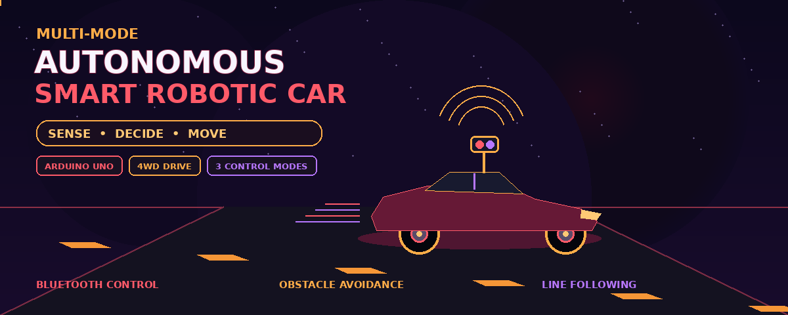

## 🔴🟠 ABSTRACT 🟠🔴

**PROJECT OVERVIEW · SYSTEM DESIGN · ENGINEERING PRINCIPLES**

This project presents the design, development, programming, and evaluation framework of a Multi-Mode Autonomous Smart Robot Car, a four-wheel-drive (4WD) robotic platform developed around the Arduino Uno microcontroller. The system combines embedded electronics, real-time sensing, wireless communication, motor control, and autonomous decision-making to demonstrate how an inexpensive robotic vehicle can navigate its environment and respond to external commands.

The proposed platform integrates an Arduino Uno based on the ATmega328P microcontroller, an L298N dual H-bridge motor driver, four geared DC motors, an HC-SR04 ultrasonic distance sensor, infrared (IR) line-tracking sensors, and an HC-05 Bluetooth communication module. An optional SG90 servo motor is added to rotate the ultrasonic sensor, allowing the robot to inspect the left and right sides before selecting a direction.

The robot is designed to operate in three primary modes. In manual mode, the user controls movement wirelessly through a Bluetooth-enabled application. In autonomous obstacle-avoidance mode, the robot measures the distance to objects, evaluates available directions, and adjusts its movement accordingly. In line-following mode, the vehicle uses infrared sensors to detect a marked path and continuously correct its direction.

The software is organized around a modular, event-driven control architecture. Pulse-width modulation (PWM) is used to regulate motor speed, while directional motor commands implement differential steering. A state-machine approach separates obstacle scanning, turning, reversing, manual control, and line tracking, reducing unnecessary blocking operations and making the firmware easier to understand and extend.

Beyond describing the hardware and source code, this report explains the mathematical principles behind distance measurement, PWM, and differential-drive motion. It also presents the circuit connections, control algorithms, construction procedure, calibration methodology, testing framework, advantages, limitations, safety considerations, and potential future improvements.

The resulting platform serves as an educational and experimental foundation for autonomous robotics. Although it does not provide the mapping, localization, or safety guarantees of an industrial autonomous vehicle, it demonstrates the essential interaction between sensing, computation, communication, and actuation in a practical embedded system.

### 🧠 Keywords

`Autonomous Robotics` · `Arduino Uno` · `ATmega328P` · `Embedded C++` · `Obstacle Avoidance` · `Line Following` · `Bluetooth` · `Ultrasonic Sensing` · `Infrared Sensors` · `PWM` · `Differential Drive` · `Robotic Vehicle`

---

## 🔴🟠 01 · INTRODUCTION 🟠🔴

**FOUNDATIONS · ENGINEERING CHALLENGES · PROJECT OBJECTIVES**

### 1.1 Background

Robotics combines mechanical design, electronic circuits, sensing technologies, control theory, and computer programming to create machines that can interact with their surroundings. Autonomous mobile robots are especially interesting because they must continuously interpret environmental information and convert it into suitable movement decisions.

A conventional remote-controlled car relies entirely on commands sent by a human operator. An autonomous robot, on the other hand, must obtain information from sensors, process that information using a controller, and determine an appropriate action without requiring a new command for every movement.

This project bridges these two approaches by combining manual remote control with two autonomous navigation techniques. The operator can intervene when required, while the robot can also follow a line or react to obstacles automatically.

The Arduino Uno is suitable for this educational application because it offers digital input/output pins, PWM outputs, analog inputs, and a widely supported programming environment. Its ATmega328P microcontroller runs at 16 MHz and provides 32 KB of flash memory, making it adequate for a compact control program of this type.

**Technical reference:** [Official Arduino Documentation](https://docs.arduino.cc/)

### 1.2 Problem Statement

Designing a mobile robot that can move reliably through an environment presents several practical challenges:

- **Obstacle detection:** The robot must detect objects in front of it before a collision occurs.
- **Path tracking:** The robot must recognize a line on the floor and correct its direction when it deviates from the path.
- **Wireless control:** The operator must be able to issue movement and mode-selection commands without a physical cable.
- **Motor coordination:** Four wheels must work together to produce forward movement, reverse movement, and turning.
- **Real-time response:** Sensor acquisition, communication, and motor control must coexist without unnecessary delays.
- **Power management:** The battery must supply the motors while providing stable power to the controller and sensors.

The central problem is therefore to design an affordable embedded system capable of switching between multiple operating modes while maintaining clear separation between sensing, decision-making, and actuation.

### 1.3 Aim of the Project

The main aim is to design and implement a four-wheel-drive robotic vehicle that supports manual Bluetooth control, autonomous obstacle avoidance, and infrared line following through a unified Arduino-based control system.

### 1.4 Specific Objectives

The project objectives are to:

1. Construct a stable 4WD robotic platform.
2. Interface four DC geared motors with an Arduino Uno through an L298N motor driver.
3. Measure obstacle distance using an HC-SR04 ultrasonic sensor.
4. Implement infrared-based line detection and path correction.
5. Establish serial communication between the Arduino and an HC-05 Bluetooth module.
6. Develop a mode-selection mechanism that allows the operator to switch between manual and autonomous functions.
7. Apply PWM to vary motor speed and improve directional control.
8. Organize the firmware into reusable functions and explicit operating states.
9. Test each subsystem separately before testing the complete robot.
10. identify the strengths, weaknesses, safety requirements, and possible future improvements of the design.

### 1.5 Project Scope

The proposed design addresses small-scale educational and laboratory robotics. It is intended for controlled indoor environments, particularly flat surfaces with sufficiently visible lines and obstacles that can be detected by an ultrasonic sensor.

The project does not claim to provide industrial-grade collision prevention, map-based navigation, artificial intelligence, or guaranteed operation on arbitrary terrain. Those capabilities require additional hardware, more advanced algorithms, or both.

### 1.6 Main Contribution

The main contribution is not simply the assembly of a robot car. It is the integration of three control modes into one embedded platform, together with a modular software design that makes the system easier to test, understand, and upgrade.

The design also demonstrates an important engineering principle: a robot should not be treated as a collection of independent components, but as a coordinated system in which sensors, algorithms, actuators, and power electronics must work together.

---

## 🔴🟠 02 · SYSTEM ARCHITECTURE 🟠🔴

**HARDWARE INTEGRATION · CONTROL STRUCTURE · SUBSYSTEM INTERACTION**

### 2.1 General System Description

The robot consists of five interacting subsystems:

**01 — Processing Subsystem**

The Arduino Uno reads sensor values, interprets Bluetooth commands, and executes the selected control algorithm.

**02 — Sensing Subsystem**

The ultrasonic sensor detects obstacles, while the IR sensors detect a line on the floor.

**03 — Communication Subsystem**

The HC-05 module transfers commands between the robot and a Bluetooth-enabled device.

**04 — Actuation Subsystem**

The L298N drives the left and right motor groups, while an optional SG90 servo positions the ultrasonic sensor.

**05 — Power Subsystem**

A battery pack supplies the motors, and a regulated supply powers the controller, sensors, communication module, and servo.

The Arduino Uno supports this role through its digital I/O, analog input, and PWM capabilities.

---

### ⚙️ SYSTEM DESIGN PHILOSOPHY

*Sense → Process → Decide → Act → Evaluate*

🔴━━━━━━━━━━━━━━━━━━━━━━━━━━━━━━━━━━━━🟠

**END OF PART I · ABSTRACT & SYSTEM ARCHITECTURE**

---

## 🔴🟠 2.2 BLOCK DIAGRAM — SYSTEM ARCHITECTURE 🟠🔴

### ⚡ THE INTELLIGENCE BEHIND THE ROBOT

**SENSING · PROCESSING · DECISION-MAKING · ACTUATION**

The following block diagram illustrates the overall architecture of the Multi-Mode Autonomous Smart Robot Car. It presents the communication interface, central processing unit, autonomous navigation algorithms, sensing components, motor driver, and four-wheel-drive locomotion system.

🔴━━━━━━━━━━━━━━━━━━━━━━━━━━━━━━━━━━━━🟠

**FIGURE 2.1 — BLOCK DIAGRAM OF THE PROPOSED SMART ROBOT CAR**

🟠━━━━━━━━━━━━━━━━━━━━━━━━━━━━━━━━━━━━🔴

### 🔬 Signal Flow and System Interaction

The arrows represent the principal information and control paths between the robot's subsystems. The architecture is organized into four functional layers: wireless communication, intelligent processing, environmental perception, and motion control.

- **Wireless communication:** The HC-05 module receives commands from a compatible smartphone or computer and transmits them to the Arduino Uno through serial communication.
- **Central processing:** The Arduino Uno interprets incoming commands, reads sensor values, selects the active operating mode, and executes the corresponding control algorithm.
- **Environmental perception:** The HC-SR04 ultrasonic sensor measures the distance to nearby obstacles, while the three-channel infrared sensor array detects the position of a line relative to the chassis.
- **Motion control:** The Arduino generates motor direction and PWM speed-control signals. The L298N driver interfaces these low-power control signals with the four DC motors.
- **Mechanical actuation:** The four geared motors drive the 4WD chassis, allowing the robot to move forward, reverse, turn, and stop.

In the proposed scanning configuration, the SG90 servo changes the orientation of the ultrasonic sensor so that the robot can compare obstacle distances in different directions. The servo is optional and must be installed and connected according to the actual hardware configuration.

**Operating principle:** The Arduino repeatedly reads the sensors, processes received commands, evaluates the selected operating mode, and updates the motor outputs. This continuous control cycle enables manual operation and autonomous navigation.

> **Engineering note:** The SG90 servo and three-sensor digital IR array belong to the expanded proposed configuration. They should be included in the final hardware list and wiring diagram if they are used in the physical implementation. The exact pin assignments and control logic must match the firmware.

---

## 🔴🟠 2.3 OPERATIONAL MODES 🟠🔴

The Multi-Mode Autonomous Smart Robot Car is designed around three principal operating modes. Each mode provides a different method of controlling the robot while using the same central microcontroller, motor driver, and drive system.

### 🚀 THREE MODES. ONE INTELLIGENT PLATFORM.

| MODE 01 | MODE 02 | MODE 03 |
|:---:|:---:|:---:|
| 🎮 Manual Control | 🚧 Obstacle Avoidance | 🛣️ Line Following |
| Human-directed | Autonomous navigation | Path tracking |

🔴━━━━━━━━━━━━━━━━━━━━━━━━━━━━━━━━━━━━🟠

### 🎮 MODE 01 — MANUAL BLUETOOTH CONTROL

*Figure 2.2 — Conceptual reference for Bluetooth-based robotic control.*

In manual mode, the operator sends movement commands from a smartphone or computer through a Bluetooth application. The HC-05 module receives these commands and forwards the corresponding serial data to the Arduino Uno.

The microcontroller interprets each command and translates it into the appropriate motor direction and speed settings. Depending on the command received, the robot can move forward, reverse, turn left, turn right, or remain stationary.

A stop command immediately requests that the motor outputs be disabled, bringing the robot to a controlled stop. The command-handling logic should also define how the system behaves when communication is interrupted.

**Control sequence:**

`Operator → Bluetooth App → HC-05 → Arduino Uno → L298N → DC Motors`

**Key characteristics:**

- Direct movement control through a wireless interface.
- Independent control of motor direction and, where implemented, speed.
- Immediate response to valid movement and stop commands.
- Convenient testing, debugging, and manual positioning.
- A foundation for testing the motors and communication subsystem before autonomous operation.

🔴━━━━━━━━━━━━━━━━━━━━━━━━━━━━━━━━━━━━🟠

### 🚧 MODE 02 — AUTONOMOUS OBSTACLE AVOIDANCE

*Figure 2.3 — Conceptual reference for an autonomous obstacle-avoidance robot.*

In autonomous obstacle-avoidance mode, the robot navigates its surroundings without requiring continuous movement commands from the operator. The HC-SR04 ultrasonic sensor measures the distance to objects located ahead of the chassis.

The Arduino continuously compares the measured distance with a predefined safety threshold. When the detected distance exceeds the threshold, the robot can continue moving forward. When an obstacle enters the safety zone, the controller initiates an avoidance procedure.

The proposed avoidance sequence consists of the following steps:

1. **Distance measurement:** The ultrasonic sensor estimates the distance to the nearest object in its current direction.
2. **Obstacle detection:** The Arduino compares the measurement with the configured safety threshold.
3. **Controlled stopping:** The motors stop when an obstacle is detected within the defined safety zone.
4. **Directional scanning:** If the SG90 servo is installed, the ultrasonic sensor is directed toward different angles to measure the available space.
5. **Direction selection:** The controller compares the measured distances and selects a direction that appears to provide sufficient clearance.
6. **Obstacle avoidance:** The robot turns toward the selected direction and resumes forward movement when the path is sufficiently clear.
7. **Recovery procedure:** If both scanned directions appear obstructed, the robot can reverse cautiously before attempting another turn.

**Control sequence:**

`Ultrasonic Sensing → Distance Evaluation → Decision-Making → Motor Control → Navigation`

**Key characteristics:**

- Autonomous detection of nearby obstacles.
- Distance-based navigation decisions.
- Optional servo-assisted scanning of the surrounding area.
- Adaptive turning decisions based on measured clearance.
- A recovery strategy for situations in which the forward path is blocked.

The effectiveness of this mode depends on sensor placement, measurement reliability, turning space, motor response, and the selected distance threshold. Ultrasonic readings can be affected by object shape, surface properties, and environmental conditions; therefore, the avoidance algorithm should include reasonable measurement validation and stopping margins.

🔴━━━━━━━━━━━━━━━━━━━━━━━━━━━━━━━━━━━━🟠

### 🛣️ MODE 03 — AUTONOMOUS LINE FOLLOWING

*Figure 2.4 — Conceptual reference for infrared-based line following.*

In autonomous line-following mode, the robot tracks a predefined path using three downward-facing infrared (IR) sensors mounted beneath the chassis. The sensors detect differences in reflected infrared light between the line and the surrounding surface.

The three sensor positions provide information about the line's relative position:

- **Left sensor:** Indicates whether the line is detected toward the left side of the robot.
- **Center sensor:** Indicates whether the line is detected near the center of the sensor array.
- **Right sensor:** Indicates whether the line is detected toward the right side of the robot.

The Arduino evaluates the combined sensor readings and determines the appropriate movement correction. When the line is detected near the center, the robot continues forward. When the line shifts toward one side, the controller adjusts the relative speeds or directions of the left and right motors to steer back toward the path.

A practical implementation must define the sensor output polarity, since some IR modules produce LOW when a line is detected while others use a different signal convention.

**Typical control behavior:**

| Left IR | Center IR | Right IR | Illustrative response |
|:---:|:---:|:---:|---|
| 0 | 1 | 0 | Move forward |
| 1 | 0 | 0 | Correct toward the left |
| 0 | 0 | 1 | Correct toward the right |
| 1 | 1 | 1 | Apply the configured intersection or wide-line behavior |
| 0 | 0 | 0 | Apply the configured line-loss response |

*Note: This table assumes `1` means that a sensor detects the line. Actual IR module polarity and the behavior for intersections or lost lines must be verified experimentally and implemented in the firmware.*

**Control sequence:**

`IR Sensor Array → Pattern Recognition → Steering Decision → PWM Adjustment → Path Tracking`

**Key characteristics:**

- Autonomous tracking of a marked path.
- Three-sensor detection for basic directional error estimation.
- Continuous steering corrections based on the observed line position.
- Differential motor control for left and right steering.
- Configurable behavior for intersections, sharp turns, and temporary line loss.

The line-following mode is particularly suitable for structured environments such as educational tracks, laboratories, demonstrations, and predefined robotic routes. Its performance depends on sensor calibration, line contrast, sensor height, chassis alignment, and motor-speed consistency.

🔴━━━━━━━━━━━━━━━━━━━━━━━━━━━━━━━━━━━━🟠

### ⚙️ 2.3.1 MODE SELECTION AND CONTROL PRIORITY

The robot's mode manager determines which control algorithm is allowed to command the motors at a given time. Manual Bluetooth control, obstacle avoidance, and line following should not independently issue conflicting motor commands.

A robust implementation should follow these principles:

- **Single active mode:** Only the selected operating mode should control the drive motors.
- **Explicit mode switching:** Each valid mode-selection command should update the active mode in a predictable manner.
- **Safe stopping:** A valid stop command should disable motor movement regardless of the current operating mode.
- **Sensor validation:** Autonomous modes should handle invalid or missing sensor measurements safely.
- **Communication-loss handling:** The firmware should define a timeout or safe-stop behavior when expected Bluetooth communication is interrupted, where applicable.
- **Clear state transitions:** Switching modes should reset or initialize any relevant control variables before the new mode begins.

These principles improve predictability, simplify debugging, and reduce the likelihood of conflicting commands during operation.

---

### 🧩 2.3.2 COMPARISON OF THE THREE MODES

| Feature | Manual Bluetooth | Obstacle Avoidance | Line Following |
|---|---|---|---|
| Primary control | Human operator | Arduino algorithm | Arduino algorithm |
| Main input | Bluetooth commands | Ultrasonic distance | Three IR sensors |
| Servo required | No | Optional for scanning | No |
| Wireless connection | Required for remote commands | Not required for autonomous movement | Not required for autonomous movement |
| Main objective | Direct movement control | Avoid obstacles | Follow a marked path |
| Motor control | Command-driven | Distance-driven | Sensor-pattern-driven |

---

## 🔴🟠 INTELLIGENCE IN MOTION 🟠🔴

**One robotic platform. Three operating modes. Multiple navigation capabilities.**

*Designed to demonstrate embedded control, wireless communication, environmental sensing, and autonomous decision-making in an integrated Arduino-based system.*

---

**Implementation note:** The diagrams and operating descriptions represent the proposed system architecture. The final behavior must be verified against the actual wiring, Arduino firmware, sensor polarity, and motor-driver connections.

# 🔴🟠 03 — HARDWARE COMPONENTS & ENGINEERING SPECIFICATIONS

# ⚙️ THE HARDWARE CORE

**PRECISION ENGINEERING · EMBEDDED CONTROL · AUTONOMOUS MOBILITY**

`ARDUINO UNO` · `L298N` · `HC-SR04` · `HC-05` · `4WD`

🔴━━━━━━━━━━━━━━━━━━━━━━━━━━━━━━━━━━━━━━━━🟠

## 3.1 — BILL OF MATERIALS (BOM)

The hardware architecture combines a microcontroller, motor-driving electronics, environmental sensors, wireless communication, and a four-wheel-drive mechanical platform. Each component contributes to a specific function within the integrated robotic system.

<table>
<thead>
<tr>
<th>Component</th>
<th>Quantity</th>
<th>Primary Function</th>
</tr>
</thead>
<tbody>
<tr><td>**Arduino Uno R3**</td><td align="center">1</td><td>Main controller and decision-making unit</td></tr>
<tr><td>**L298N Dual H-Bridge Module**</td><td align="center">1</td><td>Controls the left and right motor groups</td></tr>
<tr><td>**DC Geared Motors**</td><td align="center">4</td><td>Provide wheel movement and traction</td></tr>
<tr><td>**Robot Chassis and Wheels**</td><td align="center">1 set</td><td>Mechanical structure and mobility</td></tr>
<tr><td>**HC-SR04 Ultrasonic Sensor**</td><td align="center">1</td><td>Measures forward obstacle distance</td></tr>
<tr><td>**SG90 or Compatible Positional Servo**</td><td align="center">1</td><td>Rotates the ultrasonic sensor</td></tr>
<tr><td>**Digital IR Line Sensors**</td><td align="center">3</td><td>Detect the line and estimate its relative position</td></tr>
<tr><td>**HC-05 Bluetooth Module**</td><td align="center">1</td><td>Wireless serial communication</td></tr>
<tr><td>**Suitable Battery Pack**</td><td align="center">1</td><td>Supplies electrical power to the robot</td></tr>
<tr><td>**Regulated 5 V Converter**</td><td align="center">1</td><td>Supplies stable power to logic and sensor electronics</td></tr>
<tr><td>**Jumper Wires and Connectors**</td><td align="center">As required</td><td>Electrical interconnections</td></tr>
<tr><td>**Power Switch and Fuse**</td><td align="center">1 each</td><td>Power isolation and circuit protection</td></tr>
<tr><td>**Mounting Hardware**</td><td align="center">As required</td><td>Secures the boards, sensors, and motors</td></tr>
<tr><td>**Digital Multimeter**</td><td align="center">1 recommended</td><td>Checks voltage, continuity, motor polarity, and ground connections</td></tr>
</tbody>
</table>

🔴━━━━━━━━━━━━━━━━━━━━━━━━━━━━━━━━━━━━━━━━🟠

**ENGINEERING PRINCIPLE**

Every component must be selected according to its electrical ratings, current requirements, physical dimensions, and compatibility with the rest of the system.

🟠━━━━━━━━━━━━━━━━━━━━━━━━━━━━━━━━━━━━━━━━🔴

## 3.2 — ARDUINO UNO R3

### 🧠 THE CENTRAL PROCESSING UNIT

The Arduino Uno R3 is the central processing unit of the robot. It receives sensor signals, interprets the selected operating mode, processes Bluetooth commands, executes the navigation algorithms, and issues control signals to the motor driver.

### Principal Technical Specifications

| Parameter | Specification |
|---|---|
| Microcontroller | ATmega328P |
| Clock frequency | 16 MHz |
| Digital I/O pins | 14 |
| PWM-capable digital pins | 6 |
| Analog input pins | 6 |
| Flash memory | 32 KB |
| SRAM | 2 KB |
| EEPROM | 1 KB |

### Role Within the Robot

- **Sensor acquisition:** Reads the ultrasonic echo signal and the three digital IR sensor outputs.
- **Decision-making:** Determines whether manual control, obstacle avoidance, or line following is active.
- **Motor control:** Generates direction and PWM signals for the L298N module.
- **Wireless communication:** Receives commands through the HC-05 using serial communication.
- **Servo positioning:** Sends control signals to orient the ultrasonic sensor.

The program uses ordinary digital I/O for direction control and sensor inputs, PWM outputs for motor speed, and serial communication for Bluetooth.

<strong>⚡ Technical Design Note</strong>

The Arduino Uno R3 uses a 5 V logic architecture. Its available SRAM is limited, so the firmware should avoid unnecessary dynamic memory allocation and excessively large strings. Sensor reading, command processing, and motor control should be organized into clear, predictable routines.

The pin configuration must also avoid conflicts between hardware peripherals and software libraries. In the proposed design, D2 and D3 are used for software serial communication, while D5 and D6 provide PWM motor control.

🔴━━━━━━━━━━━━━━━━━━━━━━━━━━━━━━━━━━━━━━━━🟠

## 3.3 — L298N DUAL H-BRIDGE MOTOR DRIVER

### 🔋 FROM CONTROL SIGNALS TO MECHANICAL MOTION

The L298N module is a dual H-bridge motor driver. An H-bridge allows a DC motor to rotate in either direction by controlling the polarity of the voltage applied to it. The L298 is designed to drive inductive loads, including DC motors, and provides independent enable inputs for its two bridges.

### Functional Architecture

## 🔴 BLUETOOTH COMMUNICATION & CONTROL ARCHITECTURE 🟠

*Wireless Teleoperation • Serial Communication • Intelligent Control*

```mermaid
flowchart TB
    subgraph USER["01 — USER INTERFACE"]
        direction TB
        DEVICE["SMARTPHONE / PC<br/>Remote Control Interface"]
    end

    subgraph WIRELESS["02 — WIRELESS COMMUNICATION"]
        BT["HC-05 BLUETOOTH MODULE<br/>Wireless Data Reception"]
    end

    subgraph CONTROL["03 — EMBEDDED CONTROL"]
        MCU["ARDUINO UNO<br/>ATmega328P"]
        UART["UART SERIAL INTERFACE"]
        LOGIC["MOTOR / MODE LOGIC<br/>Command Processing"]
    end

    subgraph OUTPUT["04 — ROBOT CONTROL OUTPUT"]
        MODE{"OPERATING MODE"}
        MANUAL["MANUAL CONTROL"]
        OBSTACLE["OBSTACLE AVOIDANCE"]
        LINE["LINE FOLLOWING"]
    end

    DEVICE -->|"Bluetooth Wireless Link"| BT
    BT -->|"UART Serial Data"| UART
    UART --> MCU
    MCU --> LOGIC
    LOGIC --> MODE

    MODE --> MANUAL
    MODE --> OBSTACLE
    MODE --> LINE

    classDef device fill:#171717,stroke:#ff8c42,color:#ffffff,stroke-width:2px
    classDef wireless fill:#24140f,stroke:#ff6b35,color:#ffffff,stroke-width:2px
    classDef controller fill:#191919,stroke:#ff3b30,color:#ffffff,stroke-width:3px
    classDef logic fill:#211714,stroke:#ff8c42,color:#ffffff,stroke-width:2px
    classDef mode fill:#30120f,stroke:#ff3b30,color:#ffffff,stroke-width:2px
    classDef output fill:#171717,stroke:#ff8c42,color:#ffffff,stroke-width:2px

    class DEVICE device
    class BT wireless
    class MCU controller
    class UART,LOGIC logic
    class MODE mode
    class MANUAL,OBSTACLE,LINE output

    style USER fill:#101010,stroke:#ff8c42,stroke-width:2px
    style WIRELESS fill:#101010,stroke:#ff6b35,stroke-width:2px
    style CONTROL fill:#101010,stroke:#ff3b30,stroke-width:2px
    style OUTPUT fill:#101010,stroke:#ff8c42,stroke-width:2px
```

**🔴 FIGURE 1 — BLUETOOTH COMMUNICATION AND MULTI-MODE CONTROL FLOW 🟠**

### Motor Channel Allocation

| Driver Interface | Connection | Function |
|---|---|---|
| Bridge A | Two left-side motors | Controls the left motor group |
| Bridge B | Two right-side motors | Controls the right motor group |
| IN1 and IN2 | Arduino D7 and D8 | Left motor direction |
| IN3 and IN4 | Arduino D10 and D11 | Right motor direction |
| ENA | Arduino D5 PWM | Left motor-group speed command |
| ENB | Arduino D6 PWM | Right motor-group speed command |
| Motor supply | Appropriate battery output | Supplies motor power |
| GND | Common ground | Provides a shared electrical reference |

In this project, the four motors are connected in two side groups. The two left motors share one driver channel, and the two right motors share the other. This arrangement enables differential steering by controlling the direction and relative speed of each side.

### ⚠️ Critical Current and Thermal Limitations

The two-motors-per-channel configuration is valid only if the combined current demand of each motor pair remains within the driver's electrical and thermal limits.

Motor stall current can be substantially higher than normal running current. Before connecting all four motors to a single L298N module, obtain the motor specifications and determine the expected current under starting, turning, and stall conditions.

If the combined current is too high, use a suitable higher-current driver arrangement instead.

The L298N also dissipates power internally, producing heat and reducing the voltage delivered to the motors. A compatible heat sink does not eliminate the need to check current, temperature, and operating limits.

> **Safety requirement:** Do not select the driver based only on the motors' unloaded current. Verify the motor stall current, the driver's current limits, the board's cooling capability, and the power supply's rating.

🔴━━━━━━━━━━━━━━━━━━━━━━━━━━━━━━━━━━━━━━━━🟠

## 3.4 — FOUR DC GEARED MOTORS

### 🚙 THE FOUR-WHEEL-DRIVE PROPULSION SYSTEM

The DC geared motors convert electrical energy into wheel rotation. The integrated gearbox reduces rotational speed while increasing the torque available at the output shaft compared with the motor shaft alone.

In the four-wheel-drive configuration, the motors are arranged into two independently controlled groups:

- **Left motor group:** The front-left and rear-left motors.
- **Right motor group:** The front-right and rear-right motors.

Both motors on each side generally receive the same direction and PWM command. By changing the relative speeds of the left and right groups, the robot can move forward, reverse, and turn.

### Differential Steering Principle

## 🔴 4WD CHASSIS — MOTOR POSITION & DRIVE GROUPS 🟠

*Four-Wheel Drive Layout • Left/Right Motor Grouping*

```mermaid id="mtr4wd"
flowchart TB
    subgraph ROBOT["4WD ROBOT CHASSIS — TOP VIEW"]
        direction TB

        FRONT["▲ FRONT OF ROBOT"]

        subgraph ROW_FRONT["FRONT MOTOR AXLE"]
            direction LR
            M1["M1<br/>FRONT LEFT"]
            M2["M2<br/>FRONT RIGHT"]
        end

        subgraph ROW_REAR["REAR MOTOR AXLE"]
            direction LR
            M3["M3<br/>REAR LEFT"]
            M4["M4<br/>REAR RIGHT"]
        end

        REAR["▼ REAR OF ROBOT"]

        FRONT ~~~ ROW_FRONT
        ROW_FRONT ~~~ ROW_REAR
        ROW_REAR ~~~ REAR
    end

    subgraph GROUPS["MOTOR DRIVE GROUPS"]
        direction LR
        LEFT["LEFT GROUP<br/>M1 + M3"]
        RIGHT["RIGHT GROUP<br/>M2 + M4"]
    end

    M1 -.-> LEFT
    M3 -.-> LEFT
    M2 -.-> RIGHT
    M4 -.-> RIGHT

    classDef orientation fill:#171717,stroke:#ff8c42,color:#ffffff,stroke-width:2px
    classDef leftMotor fill:#24140f,stroke:#ff6b35,color:#ffffff,stroke-width:2px
    classDef rightMotor fill:#30120f,stroke:#ff3b30,color:#ffffff,stroke-width:2px
    classDef leftGroup fill:#211714,stroke:#ff8c42,color:#ffffff,stroke-width:3px
    classDef rightGroup fill:#25130f,stroke:#ff3b30,color:#ffffff,stroke-width:3px

    class FRONT,REAR orientation
    class M1,M3 leftMotor
    class M2,M4 rightMotor
    class LEFT leftGroup
    class RIGHT rightGroup

    style ROBOT fill:#101010,stroke:#ff8c42,stroke-width:2px
    style ROW_FRONT fill:#151515,stroke:#555555,stroke-width:1px
    style ROW_REAR fill:#151515,stroke:#555555,stroke-width:1px
    style GROUPS fill:#101010,stroke:#ff3b30,stroke-width:2px
```

**🔴 FIGURE — FOUR-WHEEL CHASSIS LAYOUT AND LEFT/RIGHT MOTOR CONFIGURATION 🟠**

---

### ⚙️ Motor Group Configuration

| Drive Group | Motor Positions | Driver Channel |
|:--|:--|:--|
| Left group | M1 + M3 | L298N Bridge A |
| Right group | M2 + M4 | L298N Bridge B |

**Engineering note:** The diagram assumes that M1 and M3 are the left-side motors, while M2 and M4 are the right-side motors. Each pair is connected to its corresponding L298N output channel, provided the combined motor current remains within the driver's limits. Check motor polarity so both wheels on each side propel the robot in the intended direction.

### Important Mechanical Considerations

- Check the direction of rotation of every motor before final assembly.
- Verify motor wiring polarity because the mounting orientation can reverse the effective wheel direction.
- Ensure that the motors on the same side work together rather than opposing each other.
- Secure the motors and wheels firmly to prevent vibration and misalignment.
- Test the chassis with its wheels raised before allowing it to move on the floor.

🔴━━━━━━━━━━━━━━━━━━━━━━━━━━━━━━━━━━━━━━━━🟠

## 3.5 — HC-SR04 ULTRASONIC DISTANCE SENSOR

### 📡 ENVIRONMENTAL DISTANCE MEASUREMENT

The HC-SR04 measures the distance to an object using ultrasonic sound waves. The Arduino sends a short trigger pulse, after which the module transmits an ultrasonic burst and produces an echo pulse whose duration corresponds to the round-trip travel time of the sound.

The documented operating procedure uses a trigger pulse of approximately 10 microseconds and recommends an interval greater than 60 milliseconds between measurements.

### Measurement Principle

## 🔴 ULTRASONIC OBSTACLE DETECTION & AVOIDANCE 🟠

*Echo-Based Distance Measurement • Real-Time Processing • Autonomous Decision-Making*

```mermaid id="qv8m2p"
flowchart TB
    subgraph DETECTION["01 — ULTRASONIC SENSING"]
        SENSOR["HC-SR04 ULTRASONIC SENSOR"]
        TX["TRANSMITTER<br/>Ultrasonic Pulse"]
        RX["RECEIVER<br/>Echo Detection"]
        OBJECT["OBSTACLE<br/>Sound Wave Reflection"]
    end

    subgraph PROCESSING["02 — DISTANCE PROCESSING"]
        MCU["ARDUINO UNO<br/>ATmega328P"]
        CALC["DISTANCE ESTIMATION<br/>Echo Time Measurement"]
    end

    subgraph DECISION["03 — AUTONOMOUS DECISION"]
        CHECK{"OBSTACLE<br/>WITHIN THRESHOLD?"}
        CLEAR["PATH CLEAR<br/>Continue Forward"]
        AVOID["OBSTACLE DETECTED<br/>Execute Avoidance Maneuver"]
    end

    SENSOR --> TX
    TX -->|"Ultrasonic Wave"| OBJECT
    OBJECT -->|"Reflected Echo"| RX
    RX -->|"ECHO Signal"| MCU
    MCU --> CALC
    CALC --> CHECK

    CHECK -->|"NO"| CLEAR
    CHECK -->|"YES"| AVOID

    classDef sensor fill:#24140f,stroke:#ff8c42,color:#ffffff,stroke-width:2px
    classDef wave fill:#171717,stroke:#ff6b35,color:#ffffff,stroke-width:2px
    classDef obstacle fill:#30120f,stroke:#ff3b30,color:#ffffff,stroke-width:2px
    classDef controller fill:#191919,stroke:#ff3b30,color:#ffffff,stroke-width:3px
    classDef processing fill:#211714,stroke:#ff8c42,color:#ffffff,stroke-width:2px
    classDef decision fill:#25130f,stroke:#ff6b35,color:#ffffff,stroke-width:2px
    classDef safe fill:#17251a,stroke:#55b878,color:#ffffff,stroke-width:2px
    classDef avoid fill:#30120f,stroke:#ff3b30,color:#ffffff,stroke-width:2px

    class SENSOR,TX,RX sensor
    class OBJECT obstacle
    class MCU controller
    class CALC processing
    class CHECK decision
    class CLEAR safe
    class AVOID avoid

    style DETECTION fill:#101010,stroke:#ff8c42,stroke-width:2px
    style PROCESSING fill:#101010,stroke:#ff3b30,stroke-width:2px
    style DECISION fill:#101010,stroke:#ff6b35,stroke-width:2px
```

**🔴 FIGURE — HC-SR04 ULTRASONIC SENSING AND AUTONOMOUS OBSTACLE AVOIDANCE 🟠**

---

### ⚙️ Operating Principle

1. **Ultrasonic Transmission:** The HC-SR04 emits an ultrasonic pulse toward the surrounding environment.
2. **Echo Reception:** The receiver detects the reflected wave after it encounters an obstacle.
3. **Distance Estimation:** The Arduino measures the echo duration and estimates the distance using:

   \[
   d=\frac{t \times v}{2}
   \]

   where \(d\) is the distance to the obstacle, \(t\) is the measured round-trip echo time, and \(v\) is the speed of sound.

4. **Decision Making:** The estimated distance is compared with a predefined safety threshold.
5. **Avoidance Action:** If an obstacle is detected within the threshold, the robot initiates its programmed avoidance maneuver; otherwise, it continues forward.

**Engineering note:** The threshold and avoidance maneuver depend on the implemented firmware. The diagram illustrates the control logic rather than specifying an unverified distance threshold or a particular turning sequence.

For a measured echo duration \(t\), the approximate distance is calculated using:

\[
d=\frac{v\,t}{2}
\]

where:

- \(d\) is the distance to the target.
- \(v\) is the speed of sound in air.
- \(t\) is the measured round-trip echo duration.
- The division by two accounts for the sound travelling to the target and back.

In practical implementations, the speed of sound is often approximated as \(343\ \text{m/s}\) near room temperature. Actual readings depend on environmental conditions and sensor characteristics.

### Role in Obstacle Avoidance

The sensor is mounted on a servo so that it can examine the front, left, and right directions. The Arduino evaluates the measured distance and determines whether the robot should continue forward, stop, scan, or turn.

**Important limitation:** The HC-SR04 is not a complete collision-prevention system. Its performance depends on the target's size, shape, orientation, acoustic reflectivity, and the operating environment. Very narrow, angled, or acoustically difficult objects may not produce reliable readings.

🔴━━━━━━━━━━━━━━━━━━━━━━━━━━━━━━━━━━━━━━━━🟠

## 3.6 — SG90 POSITIONAL SERVO MOTOR

### 🔄 ACTIVE SENSOR ORIENTATION

The SG90 or a compatible positional servo rotates the ultrasonic sensor toward selected angles. This adds directional scanning to the obstacle-avoidance system without requiring a second ultrasonic sensor.

### Proposed Servo Angles

| Commanded Angle | Intended Direction |
|---:|---|
| 90° | Forward |
| 150° | Left |
| 30° | Right |

These angles are initial settings. The actual direction depends on the physical orientation of the servo and its mounting bracket. Recalibrate the angles so that the sensor faces the intended direction.

The Arduino Servo library provides the interface for setting the commanded servo position.

### Power and Integration

- Connect the servo signal wire to Arduino D12 in the proposed pin configuration.
- Supply the servo from a regulated source capable of providing its current demand.
- Establish a common ground between the servo supply and Arduino when required by the signal interface.
- Keep the servo wiring secure to prevent movement or intermittent connections during scanning.

> **Power warning:** Connecting a servo directly to the Arduino 5 V pin can cause voltage dips, resets, or unreliable behavior, particularly when the servo starts moving or encounters mechanical resistance. Use an appropriately rated regulated supply.

🔴━━━━━━━━━━━━━━━━━━━━━━━━━━━━━━━━━━━━━━━━🟠

## 3.7 — INFRARED LINE-TRACKING SENSOR ARRAY

### 🛣️ PATH DETECTION & STEERING CORRECTION

The infrared modules typically contain an infrared emitter and a light-sensitive receiver. Their outputs change according to the amount of reflected infrared light.

A black line on a light-colored floor often produces a different reading from the surrounding surface. The controller uses these differences to estimate whether the line is positioned toward the left, near the center, or toward the right of the sensor array.

### Three-Sensor Configuration

| Sensor | Position | Primary Function |
|---|---|---|
| Left IR sensor | Left side | Detects a line displaced toward the left |
| Center IR sensor | Center | Indicates whether the line is approximately centered |
| Right IR sensor | Right side | Detects a line displaced toward the right |

The three digital outputs connect to Arduino pins A2, A3, and A4, respectively, in left-to-right order.

### Line Detection and Control

```mermaid
flowchart TB
    subgraph SENSING["01 — INTELLIGENT SENSING"]
        direction TB
        L["◉ LEFT IR SENSOR"]
        C["◉ CENTER IR SENSOR"]
        R["◉ RIGHT IR SENSOR"]
    end

    subgraph PROCESSING["02 — EMBEDDED PROCESSING"]
        MCU["ARDUINO UNO<br/>ATmega328P"]
        LOGIC["LINE POSITION ANALYSIS<br/>Sensor Pattern Recognition"]
        DECISION{"STEERING<br/>DECISION"}
    end

    subgraph ACTUATION["03 — MOTION CONTROL"]
        PWM["DUAL PWM CONTROL<br/>Left / Right Speed Adjustment"]
        DRIVER["L298N MOTOR DRIVER<br/>Dual H-Bridge"]
    end

    subgraph MOVEMENT["04 — AUTONOMOUS NAVIGATION"]
        LEFT["LEFT CORRECTION"]
        FORWARD["FORWARD MOTION"]
        RIGHT["RIGHT CORRECTION"]
        PATH(["AUTONOMOUS PATH TRACKING"])
    end

    L --> MCU
    C --> MCU
    R --> MCU

    MCU --> LOGIC
    LOGIC --> DECISION

    DECISION --> PWM
    PWM --> DRIVER

    DRIVER --> LEFT
    DRIVER --> FORWARD
    DRIVER --> RIGHT

    LEFT --> PATH
    FORWARD --> PATH
    RIGHT --> PATH

    classDef sensor fill:#171717,stroke:#ff8c42,color:#ffffff,stroke-width:2px
    classDef controller fill:#191919,stroke:#ff3b30,color:#ffffff,stroke-width:3px
    classDef logic fill:#211714,stroke:#ff6b35,color:#ffffff,stroke-width:2px
    classDef driver fill:#25130f,stroke:#ff3b30,color:#ffffff,stroke-width:2px
    classDef movement fill:#171717,stroke:#ff8c42,color:#ffffff,stroke-width:2px
    classDef final fill:#ff3b30,stroke:#ff8c42,color:#ffffff,stroke-width:3px

    class L,C,R sensor
    class MCU controller
    class LOGIC,DECISION logic
    class PWM,DRIVER driver
    class LEFT,FORWARD,RIGHT movement
    class PATH final

    style SENSING fill:#101010,stroke:#ff8c42,stroke-width:2px
    style PROCESSING fill:#101010,stroke:#ff3b30,stroke-width:2px
    style ACTUATION fill:#101010,stroke:#ff6b35,stroke-width:2px
    style MOVEMENT fill:#101010,stroke:#ff8c42,stroke-width:2px
```

**🔴 FIGURE — INTELLIGENT IR LINE-TRACKING CONTROL ARCHITECTURE 🟠**

The active output polarity differs among sensor modules. In the proposed firmware, `LOW` is treated as line detection by default. Change that setting after testing the particular modules used in the physical build.

### Installation Considerations

- Mount the sensors securely underneath the front of the chassis.
- Keep the sensors at a suitable height above the floor.
- Position the sensors in left-to-right order.
- Calibrate the sensors using the actual line and surface.
- Test the output polarity before implementing the line-following logic.
- Define safe behavior for intersections and situations in which the line is lost.

The recommended sensor height and spacing depend on the specific sensor boards, line width, and surface finish.

🔴━━━━━━━━━━━━━━━━━━━━━━━━━━━━━━━━━━━━━━━━🟠

## 3.8 — HC-05 BLUETOOTH COMMUNICATION MODULE

### 📱 WIRELESS COMMAND & CONTROL INTERFACE

The HC-05 provides a wireless serial connection between the robot and a compatible smartphone or computer. A Bluetooth application transmits simple character commands, which the Arduino reads and converts into control actions.

The proposed command interface is deliberately simple, allowing the robot to be controlled with most compatible serial Bluetooth terminal applications or a suitable custom interface.

### Communication Flow

## 🔴 BLUETOOTH COMMUNICATION & MODE CONTROL 🟠

*Wireless Teleoperation • UART Serial Communication • Embedded Decision Logic*

```mermaid
flowchart TB
    subgraph INPUT["01 — REMOTE CONTROL INTERFACE"]
        DEVICE["SMARTPHONE / PC<br/>User Command Interface"]
    end

    subgraph COMMUNICATION["02 — BLUETOOTH COMMUNICATION"]
        BT["HC-05 BLUETOOTH MODULE"]
    end

    subgraph PROCESSING["03 — EMBEDDED PROCESSING"]
        UART["UART SERIAL COMMUNICATION"]
        MCU["ARDUINO UNO<br/>ATmega328P"]
        LOGIC["MOTOR / MODE LOGIC<br/>Command Interpretation"]
    end

    DEVICE -->|"Bluetooth Wireless Link"| BT
    BT -->|"UART Serial Data"| UART
    UART --> MCU
    MCU --> LOGIC

    classDef input fill:#171717,stroke:#ff8c42,color:#ffffff,stroke-width:2px
    classDef bluetooth fill:#24140f,stroke:#ff6b35,color:#ffffff,stroke-width:2px
    classDef controller fill:#191919,stroke:#ff3b30,color:#ffffff,stroke-width:3px
    classDef processing fill:#211714,stroke:#ff8c42,color:#ffffff,stroke-width:2px

    class DEVICE input
    class BT bluetooth
    class MCU controller
    class UART,LOGIC processing

    style INPUT fill:#101010,stroke:#ff8c42,stroke-width:2px
    style COMMUNICATION fill:#101010,stroke:#ff6b35,stroke-width:2px
    style PROCESSING fill:#101010,stroke:#ff3b30,stroke-width:2px
```

**🔴 FIGURE — BLUETOOTH COMMAND TRANSMISSION AND EMBEDDED CONTROL FLOW 🟠**

---

### ⚙️ Communication Workflow

1. **Command Input:** The user sends a command from a smartphone or PC.
2. **Wireless Transmission:** The HC-05 receives the command through the Bluetooth connection.
3. **Serial Communication:** The command is transferred to the Arduino Uno through the UART interface.
4. **Command Processing:** The Arduino interprets the received command and passes control to the motor or operating-mode logic.

### Electrical Compatibility

On common HC-05 breakout boards, the power input may accept 5 V because the board includes a regulator. However, the serial RX logic input may still require a reduced signal level.

Protect the module by placing a suitable voltage divider or level shifter between Arduino TX and HC-05 RX. One reference circuit uses 1 kΩ and 2 kΩ resistors to reduce the Arduino's 5 V TX signal.

The example firmware uses software serial at 9600 baud. The module must be configured for a matching baud rate in normal data mode.

> **Compatibility warning:** Check the exact module's documentation before applying power. A bare HC-05 module and a regulator-equipped breakout board are not electrically identical.

🔴━━━━━━━━━━━━━━━━━━━━━━━━━━━━━━━━━━━━━━━━🟠

## 3.9 — BATTERY & POWER DISTRIBUTION SYSTEM

### 🔋 STABLE POWER · RELIABLE CONTROL · SAFE OPERATION

The power system must support two different categories of electrical load:

- **Motors:** Demand comparatively high current, particularly during starting or sudden direction changes.
- **Logic and sensors:** Require a stable supply voltage to prevent microcontroller resets and false readings.

A suitable design uses an appropriately rated battery pack for the motors and a regulated 5 V supply for the Arduino and logic components, sharing a common ground where required by the driver and signal interfaces.

### Power-System Overview

## 🟠 POWER SUPPLY & ELECTRICAL DISTRIBUTION ARCHITECTURE 🔴

*Protected Battery Input • Motor Power • Regulated Logic Supply*

```mermaid
flowchart TB
    BAT["BATTERY PACK<br/>DC Power Source"]
    SWITCH["POWER SWITCH"]
    FUSE["PROTECTION FUSE"]

    subgraph DISTRIBUTION["POWER DISTRIBUTION"]
        direction TB

        MOTOR_BRANCH["MOTOR POWER BRANCH"]
        LOGIC_BRANCH["REGULATED SUPPLY BRANCH"]

        DRIVER["L298N MOTOR DRIVER<br/>Dual H-Bridge"]
        MOTORS["FOUR DC GEARED MOTORS"]

        MCU["ARDUINO UNO<br/>Controller & Logic"]
        BT["HC-05<br/>Bluetooth Module"]
        IR["IR LINE SENSORS"]
        SONAR["HC-SR04<br/>Ultrasonic Sensor"]
        SERVO["SG90 SERVO*"]
    end

    BAT --> SWITCH
    SWITCH --> FUSE

    FUSE --> MOTOR_BRANCH
    FUSE --> LOGIC_BRANCH

    MOTOR_BRANCH --> DRIVER
    DRIVER --> MOTORS

    LOGIC_BRANCH --> MCU
    LOGIC_BRANCH --> BT
    LOGIC_BRANCH --> IR
    LOGIC_BRANCH --> SONAR
    LOGIC_BRANCH --> SERVO

    GND["COMMON GROUND<br/>Required Signal Reference"]

    MCU -.-> GND
    DRIVER -.-> GND
    BT -.-> GND
    IR -.-> GND
    SONAR -.-> GND
    SERVO -.-> GND

    classDef battery fill:#24140f,stroke:#ff3b30,color:#ffffff,stroke-width:3px
    classDef protection fill:#211714,stroke:#ff8c42,color:#ffffff,stroke-width:2px
    classDef branch fill:#171717,stroke:#ff6b35,color:#ffffff,stroke-width:2px
    classDef motor fill:#30120f,stroke:#ff3b30,color:#ffffff,stroke-width:2px
    classDef logic fill:#191919,stroke:#ff8c42,color:#ffffff,stroke-width:2px
    classDef ground fill:#171717,stroke:#b8b8b8,color:#ffffff,stroke-width:2px

    class BAT battery
    class SWITCH,FUSE protection
    class MOTOR_BRANCH,LOGIC_BRANCH branch
    class DRIVER,MOTORS motor
    class MCU,BT,IR,SONAR,SERVO logic
    class GND ground

    style DISTRIBUTION fill:#101010,stroke:#ff8c42,stroke-width:2px
```

**🟠 FIGURE 2 — PROTECTED POWER DISTRIBUTION AND ELECTRICAL SUPPLY 🟠**

**Engineering notes:**

- The motor supply and regulated logic supply must match the voltage and current requirements of their connected components.
- The servo power supply must support its peak current demand.
- All connected modules must share a suitable common ground for their signal interfaces.
- The fuse must be appropriately rated for the wiring and expected current.
- Do not connect the battery directly to the Arduino's 5V pin unless the supply is properly regulated to 5V and the connection is suitable for the board.

<CodeBlock language="markdown" editable>
---

## ⚙️ SYSTEM ARCHITECTURE SUMMARY

| Subsystem | Main Component | Primary Function |
|:--|:--|:--|
| User Interface | Smartphone / PC | Sends remote-control commands |
| Wireless Link | HC-05 | Transfers commands through Bluetooth |
| Central Controller | Arduino Uno | Processes commands and sensor data |
| Motor Control | L298N | Controls motor direction and speed |
| Obstacle Detection | HC-SR04 | Measures distance to obstacles |
| Line Detection | IR Sensors | Detects the line and supports tracking |
| Steering Mechanism | SG90 Servo (optional) | Positions the ultrasonic sensor |
| Power System | Battery, Fuse, Regulator | Supplies protected power to the system |

> **Design principle:** The Arduino Uno acts as the central controller, while the Bluetooth interface enables remote operation and the sensing subsystem supports autonomous navigation. The power distribution system supplies the motors and electronics through appropriate power paths.

---

### Example: Two 18650 Cells in Series

If two conventional 18650 lithium-ion cells are connected in series, the pack is nominally 7.4 V and reaches approximately 8.4 V when fully charged, assuming 3.7 V nominal cells charged to 4.2 V each.

This voltage must be checked against the motors and driver before use.

### Battery Safety Requirements

- Use a properly assembled and protected battery pack with a compatible charger and battery-management arrangement.
- Check battery polarity before connecting the circuit.
- Choose wiring, connectors, and a fuse suitable for the expected current.
- Prevent short circuits and protect the battery against physical damage.
- Confirm that the regulated supply can provide sufficient current for the connected electronics.
- Never connect an unregulated motor battery directly to the Arduino's 5 V pin.
- Do not assume that an L298N module's onboard regulator or jumper is configured identically on every board.

Incorrect charging, short circuits, physical damage, or the use of unsuitable loose 18650 cells can create fire and injury risks.

---

# 🔴🟠 04 — ELECTRICAL WIRING & PIN CONFIGURATION

**SIGNAL ROUTING · MOTOR CONTROL · SENSOR INTEGRATION**

🔴━━━━━━━━━━━━━━━━━━━━━━━━━━━━━━━━━━━━━━━━🟠

A consistent pin map prevents conflicts between the motor driver, sensor inputs, servo, and Bluetooth serial connection. The following configuration is the proposed wiring arrangement for the firmware described in this project.

## 4.1 — ARDUINO PIN ASSIGNMENT

| Arduino Pin | Connected Component | Function |
|---|---|---|
| D2 | HC-05 TXD → Arduino | Bluetooth serial RX |
| D3 | Arduino → HC-05 RXD | Bluetooth serial TX through a level divider |
| D5 (PWM) | L298N ENA | Left motor-group speed |
| D6 (PWM) | L298N ENB | Right motor-group speed |
| D7 | L298N IN1 | Left motor direction |
| D8 | L298N IN2 | Left motor direction |
| D10 | L298N IN3 | Right motor direction |
| D11 | L298N IN4 | Right motor direction |
| D12 | Servo signal | Ultrasonic sensor positioning |
| A0 | HC-SR04 TRIG | Ultrasonic trigger |
| A1 | HC-SR04 ECHO | Echo pulse input |
| A2 | Left IR sensor output | Left line detection |
| A3 | Center IR sensor output | Center line detection |
| A4 | Right IR sensor output | Right line detection |
| GND | All relevant modules | Common signal reference |

Pins A0–A4 are used as digital I/O in addition to their analog-input functionality.

### Pin-Map Design Notes

- D5 and D6 provide PWM outputs for the two motor groups.
- D7, D8, D10, and D11 provide the direction signals for the L298N.
- D2 and D3 are assigned to software serial communication with the HC-05.
- A0 and A1 provide the trigger and echo connections for the HC-SR04.
- A2, A3, and A4 read the three IR sensor outputs.
- D12 provides the servo control signal.

Verify the selected pins against the exact firmware and the libraries used by the project before powering the circuit.

🔴━━━━━━━━━━━━━━━━━━━━━━━━━━━━━━━━━━━━━━━━🟠

## 4.2 — L298N MOTOR CONNECTIONS

| L298N Terminal | Connection |
|---|---|
| OUT1 and OUT2 | Two left-side motors, connected in parallel |
| OUT3 and OUT4 | Two right-side motors, connected in parallel |
| ENA | Arduino D5 |
| IN1 | Arduino D7 |
| IN2 | Arduino D8 |
| ENB | Arduino D6 |
| IN3 | Arduino D10 |
| IN4 | Arduino D11 |
| Motor supply | Appropriate motor battery voltage |
| GND | Battery negative and Arduino common ground |

If the board's ENA and ENB jumpers permanently enable the motor channels, remove them when using D5 and D6 for PWM, following the documentation for the actual board.

When testing for the first time, raise the wheels clear of the floor. If one motor rotates backward relative to its partner, disconnect power and correct that motor's wiring polarity.

> **Current verification:** Confirm that the two motors connected to each bridge do not exceed the driver's current and thermal limits. If they do, select a suitable driver configuration before operating the robot.

🔴━━━━━━━━━━━━━━━━━━━━━━━━━━━━━━━━━━━━━━━━🟠

## 4.3 — HC-SR04 CONNECTIONS

| HC-SR04 Pin | Arduino Connection |
|---|---|
| VCC | Regulated 5 V |
| GND | Common ground |
| TRIG | Arduino A0 |
| ECHO | Arduino A1 |

The commonly used HC-SR04 provides 5 V logic signals. When replacing it with a 3.3 V sensor or another variant, verify the signal-level requirements.

🔴━━━━━━━━━━━━━━━━━━━━━━━━━━━━━━━━━━━━━━━━🟠

## 4.4 — IR SENSOR CONNECTIONS

Each sensor's power and ground connect to the appropriate regulated supply and common ground. Their three digital outputs connect to A2, A3, and A4 in left-to-right order.

| IR Sensor | Output Connection |
|---|---|
| Left sensor | Arduino A2 |
| Center sensor | Arduino A3 |
| Right sensor | Arduino A4 |
| VCC | Appropriate regulated supply |
| GND | Common ground |

The sensors should be securely mounted underneath the front of the chassis and positioned close enough to the floor for dependable reflection measurements. The recommended height and spacing depend on the particular sensor boards, line width, and surface finish.

🔴━━━━━━━━━━━━━━━━━━━━━━━━━━━━━━━━━━━━━━━━🟠

## 4.5 — HC-05 CONNECTIONS

| HC-05 Pin | Arduino Connection |
|---|---|
| TXD | D2 |
| RXD | D3 through a voltage divider or level shifter |
| GND | Common ground |
| VCC | Supply appropriate for the exact HC-05 board |

The example firmware uses software serial at 9600 baud. The module must be configured for a matching baud rate in normal data mode.

### 🔌 Recommended Pre-Power Checklist

- [ ] Verify the Arduino pin assignments against the firmware.
- [ ] Confirm the polarity of the battery and motor connections.
- [ ] Check that all required grounds are connected.
- [ ] Verify the HC-05 RX voltage-level protection.
- [ ] Confirm that the servo and regulated supply can handle their expected current.
- [ ] Check the L298N current and thermal limits.
- [ ] Verify the IR sensor output polarity.
- [ ] Raise the wheels clear of the floor for the first motor test.
- [ ] Test the emergency stop and motor-stop behavior before autonomous operation.

---

## 🔴🟠 ENGINEERED FOR CONTROL. DESIGNED FOR AUTONOMY. 🟠🔴

**MULTI-MODE AUTONOMOUS SMART ROBOT CAR**

*University of Boumerdes — IGEE*

## 4.6 Power Wiring Diagram

### 🔴 PROTECTED POWER DISTRIBUTION ARCHITECTURE 🟠

*Battery Protection • Motor Supply • Regulated 5 V Logic Supply*

```mermaid
flowchart TB
    BAT["PROTECTED BATTERY PACK"]
    FUSE["PROTECTION FUSE"]
    SWITCH["POWER SWITCH"]

    subgraph POWER["POWER DISTRIBUTION"]
        direction LR
        MOTOR["MOTOR SUPPLY"]
        BUCK["5 V BUCK CONVERTER"]
    end

    subgraph MOTOR_SYSTEM["MOTOR POWER BRANCH"]
        DRIVER["L298N MOTOR DRIVER"]
        MOTORS["FOUR DC MOTORS"]
    end

    subgraph LOGIC_SYSTEM["REGULATED LOGIC POWER — 5 V"]
        direction TB
        ARDUINO["ARDUINO UNO<br/>5 V Input"]
        IR["IR LINE SENSORS"]
        SONAR["HC-SR04"]
        BT["HC-05 BLUETOOTH MODULE*"]
        SERVO["SERVO MOTOR**"]
    end

    BAT --> FUSE
    FUSE --> SWITCH
    SWITCH --> MOTOR
    SWITCH --> BUCK

    MOTOR --> DRIVER
    DRIVER --> MOTORS

    BUCK --> ARDUINO
    BUCK --> IR
    BUCK --> SONAR
    BUCK --> BT
    BUCK --> SERVO

    GND["COMMON GROUND REFERENCE"]

    BAT -. "Battery negative" .-> GND
    DRIVER -.-> GND
    ARDUINO -.-> GND
    IR -.-> GND
    SONAR -.-> GND
    BT -.-> GND
    SERVO -.-> GND

    classDef battery fill:#30120f,stroke:#ff3b30,color:#ffffff,stroke-width:3px
    classDef protection fill:#24140f,stroke:#ff8c42,color:#ffffff,stroke-width:2px
    classDef power fill:#171717,stroke:#ff6b35,color:#ffffff,stroke-width:2px
    classDef motor fill:#30120f,stroke:#ff3b30,color:#ffffff,stroke-width:2px
    classDef logic fill:#191919,stroke:#ff8c42,color:#ffffff,stroke-width:2px
    classDef ground fill:#171717,stroke:#b8b8b8,color:#ffffff,stroke-width:2px

    class BAT battery
    class FUSE,SWITCH protection
    class MOTOR,BUCK power
    class DRIVER,MOTORS motor
    class ARDUINO,IR,SONAR,BT,SERVO logic
    class GND ground

    style POWER fill:#101010,stroke:#ff8c42,stroke-width:2px
    style MOTOR_SYSTEM fill:#101010,stroke:#ff3b30,stroke-width:2px
    style LOGIC_SYSTEM fill:#101010,stroke:#ff8c42,stroke-width:2px
```

**FIGURE — PROTECTED BATTERY DISTRIBUTION AND REGULATED POWER ARCHITECTURE**

### ⚠️ Electrical Design Notes

- **Initial development:** Power the Arduino through USB and the motors through their appropriate motor supply. Connect the required grounds together.
- **Power isolation:** Do not connect competing 5 V supplies together without a suitable power-selection or isolation arrangement.
- **HC-05:** Verify the voltage rating of the exact Bluetooth breakout board before connecting its power input.
- **Servo:** Ensure the supply can deliver the servo's peak current without causing voltage drops or controller resets.
- **L298N:** Verify the motor voltage, combined current demand, and driver thermal limits.
- **Common ground:** Establish a suitable common ground reference for the controller, driver, and signal-connected modules.

> **Important:** This is a functional power-distribution diagram. Actual wiring depends on the battery configuration, regulator design, specific modules, and their current requirements.

---

# 5. Mathematical Foundations

The robot's behavior can be explained using a few key equations from acoustics, electronics, and differential-drive kinematics.

# 🔴 5. MATHEMATICAL FOUNDATIONS 🟠

**Ultrasonic Distance Measurement • PWM Motor Control**

*Mathematical models underlying the robot's sensing and motion-control systems.*

---

## 5.1 Ultrasonic Distance Measurement

The HC-SR04 ultrasonic sensor estimates the distance to an obstacle by transmitting an ultrasonic pulse and measuring the time required for its echo to return. Since the sound wave travels to the target and back, the measured time represents a round-trip journey.

### 📐 Fundamental Equation

$$
\boxed{d=\frac{c\,t}{2}}
$$

Where:

- $d$ — Distance to the target.
- $c$ — Speed of sound in air.
- $t$ — Measured round-trip echo time.
- $2$ — Accounts for the outward and return journeys.

At approximately $20^\circ\mathrm{C}$, the speed of sound is approximately:

$$
c=343\ \mathrm{m/s}
$$

Converting this value into centimetres per microsecond gives:

$$
c\approx0.0343\ \mathrm{cm}/\mu\mathrm{s}
$$

Therefore, the distance in centimetres can be calculated as:

$$
\boxed{d_{\mathrm{cm}}=\frac{t_{\mu s}\times0.0343}{2}}
$$

### 🧮 Worked Example

For a measured echo duration of $1000\ \mu\mathrm{s}$:

$$
d=\frac{1000\times0.0343}{2}
$$

$$
\boxed{d=17.15\ \mathrm{cm}}
$$

This means the obstacle is estimated to be approximately $17.15$ centimetres from the sensor.

### ⚡ Simplified HC-SR04 Approximation

A commonly used approximation for Arduino projects is:

$$
\boxed{d_{\mathrm{cm}}\approx\frac{t_{\mu s}}{58}}
$$

For the same echo duration:

$$
d_{\mathrm{cm}}\approx\frac{1000}{58}
\approx17.24\ \mathrm{cm}
$$

The small difference between the two results comes from rounding the conversion constant.

### 🔄 Measurement Workflow

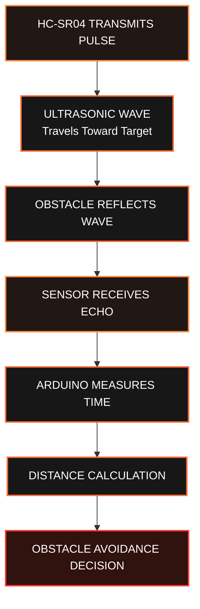

**FIGURE 5.1 — ULTRASONIC DISTANCE-MEASUREMENT PROCESS**

### ⚠️ Measurement Limitations

The calculated distance is an estimate rather than an exact measurement. Temperature affects the speed of sound, while target angle, surface geometry, reflections, and environmental conditions can affect echo detection.

---

## 5.2 Pulse-Width Modulation (PWM)

Pulse-Width Modulation (PWM) controls the average electrical power delivered to a load by switching a signal between ON and OFF states. In this robotic platform, PWM commands can be applied to the L298N motor driver's enable inputs to regulate motor drive.

### 📐 Duty-Cycle Equation

The duty cycle is the fraction of one switching period during which the signal remains ON.

$$
D = \frac{T_{\mathrm{ON}}}{T_{\mathrm{ON}} + T_{\mathrm{OFF}}}
$$

The total switching period is:

$$
T = T_{\mathrm{ON}} + T_{\mathrm{OFF}}
$$

Therefore:

$$
D = \frac{T_{\mathrm{ON}}}{T}
$$

Expressed as a percentage:

$$
D_{\mathrm{percent}} = 100D
$$

Where:

- `D` — Duty cycle, expressed as a fraction.
- `D_percent` — Duty cycle, expressed as a percentage.
- `T_ON` — Signal ON duration.
- `T_OFF` — Signal OFF duration.
- `T` — Total switching period.

### 🎛️ Arduino PWM Command

For the conventional 8-bit `analogWrite()` scale used on the Arduino Uno, the command ranges from `0` to `255`.

The approximate commanded duty cycle is:

$$
D_{\mathrm{percent}} \approx \frac{PWM}{255} \times 100
$$

For example, if the Arduino sends a PWM command of `128`:

$$
D_{\mathrm{percent}} \approx \frac{128}{255} \times 100
$$

$$
D_{\mathrm{percent}} \approx 50.2\%
$$

Thus, a command of `128` corresponds to approximately half-scale PWM output.

### 📊 PWM Command Reference

| PWM Command | Approximate Duty Cycle | Interpretation |
|:---:|:---:|:---|
| 0 | 0% | No PWM output |
| 64 | 25.1% | Low commanded output |
| 128 | 50.2% | Medium commanded output |
| 192 | 75.3% | Higher commanded output |
| 255 | 100% | Maximum commanded output |

*These percentages describe the PWM command, not the exact motor speed. Actual speed depends on battery voltage, driver losses, motor characteristics, and mechanical load.*

---

### 📈 PWM Signal Concept

**FIGURE 5.2 — PWM-BASED MOTOR DRIVE CONTROL**

### ⚙️ Relationship Between PWM and Motor Speed

PWM changes the motor's applied drive conditions, but the duty cycle does not directly specify the exact rotational speed.

Actual speed depends on several factors:

- Battery voltage and its state of charge.
- Voltage drop and power dissipation in the L298N driver.
- DC motor electrical and mechanical characteristics.
- Wheel load, traction, and friction.
- Starting torque and mechanical resistance.

Consequently, a PWM command of approximately $50\%$ does **not** guarantee that the motor rotates at exactly $50\%$ of its maximum speed.

---

## 5.3 Application to Autonomous Robot Control

The ultrasonic and PWM models work together in the robot's obstacle-avoidance system. The Arduino estimates the distance to an obstacle, compares that estimate with a configured safety threshold, and selects a programmed movement response.

Let $d$ represent the estimated distance and $d_{\mathrm{safe}}$ the configured safety threshold.

$$
\boxed{
\begin{cases}
\text{Avoidance maneuver}, & d\leq d_{\mathrm{safe}}\\[4pt]
\text{Continue forward}, & d>d_{\mathrm{safe}}
\end{cases}
}
$$

The selected action is translated into motor-direction signals and PWM commands for the L298N driver.

**🔴 FROM SENSOR MEASUREMENTS TO INTELLIGENT MOTION CONTROL 🟠**

*Distance Estimation → Decision Logic → Motor Command → Robot Movement*

---

## 📌 Mathematical Summary

| Model | Equation | Application |
|:--|:--|:--|
| Ultrasonic distance | `d = c * t / 2` | Estimates obstacle distance |
| HC-SR04 approximation | `d_cm ≈ t_us / 58` | Simplifies embedded calculations |
| PWM duty cycle | `D = T_ON / (T_ON + T_OFF)` | Defines the ON-time fraction |
| PWM percentage | `D_percent = 100 * D` | Expresses the duty cycle as a percentage |
| Arduino PWM command | `D_percent ≈ (PWM / 255) * 100` | Estimates the commanded PWM percentage |

## 5.3 Differential-Drive Kinematics

Although the chassis has four wheels, the proposed controller treats them as two groups: left and right.

### 📐 Kinematic Variables

Let:

- `v_L` be the left-side linear wheel velocity.
- `v_R` be the right-side linear wheel velocity.
- `b` be the effective distance between the left and right wheel paths.
- `v` be the vehicle's forward velocity.
- `omega` be the angular turning velocity.

### 🔴 Linear Velocity

The simplified differential-drive model gives:

$$
v = \frac{v_R + v_L}{2}
$$

### 🟠 Angular Velocity

The angular turning velocity is:

$$
\omega = \frac{v_R - v_L}{b}
$$

### ⚙️ Turning Behavior

| Left-Side Speed | Right-Side Speed | Robot Motion |
|:--|:--|:--|
| Approximately equal | Approximately equal | Straight movement |
| Slower | Faster | Turns left |
| Faster | Slower | Turns right |
| Forward | Reverse | Approximately in-place pivot |

When both sides move forward at approximately equal speeds, the robot travels approximately straight.

When the right side moves faster than the left, the robot turns left. When the left side moves faster than the right, the robot turns right.

When the two sides move in opposite directions, the robot can perform an approximately in-place pivot, subject to wheel traction and chassis geometry.

### 🧭 Differential-Drive Control Architecture

```mermaid id="diff53"
flowchart TB
    MCU["ARDUINO UNO"]
    SPEED["LEFT / RIGHT SPEED COMMANDS"]
    DRIVER["L298N DUAL H-BRIDGE"]
    
    subgraph DRIVE["4WD DIFFERENTIAL DRIVE"]
        direction LR
        LEFT["LEFT GROUP<br/>M1 + M3"]
        RIGHT["RIGHT GROUP<br/>M2 + M4"]
    end

    MOTION["ROBOT TRANSLATION<br/>AND ROTATION"]

    MCU --> SPEED
    SPEED --> DRIVER
    DRIVER --> LEFT
    DRIVER --> RIGHT
    LEFT --> MOTION
    RIGHT --> MOTION

    classDef controller fill:#191919,stroke:#ff3b30,color:#ffffff,stroke-width:3px
    classDef control fill:#211714,stroke:#ff8c42,color:#ffffff,stroke-width:2px
    classDef motor fill:#25130f,stroke:#ff6b35,color:#ffffff,stroke-width:2px
    classDef motion fill:#30120f,stroke:#ff3b30,color:#ffffff,stroke-width:3px

    class MCU controller
    class SPEED control
    class DRIVER,LEFT,RIGHT motor
    class MOTION motion

    style DRIVE fill:#101010,stroke:#ff8c42,stroke-width:2px
```

**FIGURE 5.3 — DIFFERENTIAL-DRIVE KINEMATICS AND MOTOR GROUP CONTROL**

The model is an approximation because tire slip, wheel alignment, and variations between motors affect real motion.

---

## 5.4 Obstacle-Avoidance Decision Rule

Let `d_f` denote the measured distance ahead and `d_safe` denote the safety threshold.

### 📐 Obstacle Detection Condition

The initial rule is:

$$
\text{Obstacle detected if } d_f < d_{\mathrm{safe}}
$$

For this implementation:

$$
d_{\mathrm{safe}} = 25\ \mathrm{cm}
$$

This is a tunable initial setting rather than a universal safe stopping distance. The appropriate threshold depends on vehicle speed, braking behavior, sensor placement, and the available space.

### 🟠 Selecting an Avoidance Direction

After detection, the robot compares left and right measurements:

$$
d_{\mathrm{best}} = \max(d_L,d_R)
$$

Where:

- `d_L` is the measured distance on the left.
- `d_R` is the measured distance on the right.
- `d_best` is the larger of the two measured distances.

If neither side offers the minimum clearance, the robot reverses before turning toward the side with the greater measured distance. This is a simple heuristic, not a complete geometric map of the surroundings.

### 🚦 Decision Logic

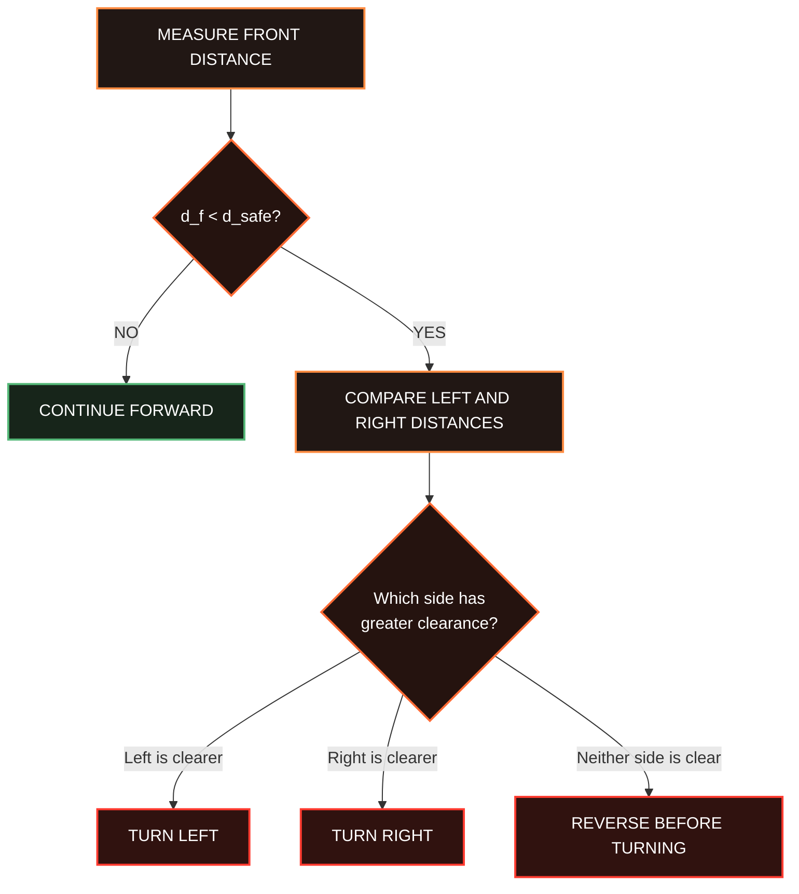

**FIGURE 5.4 — DISTANCE-BASED OBSTACLE-AVOIDANCE DECISION FLOW**

---

## 5.5 Line-Tracking Error

A three-sensor digital array provides a rough estimate of the line's position.

### 🔍 Rule-Based Sensor Interpretation

| Sensor Condition | Steering Response |
|:--|:--|
| Left sensor active | Steer left |
| Center sensor active | Move forward |
| Right sensor active | Steer right |
| Left and center active | Make a gentle left correction |
| Center and right active | Make a gentle right correction |
| No sensors active | Treat the line as temporarily lost |

*The meaning of an active sensor depends on its output polarity and the firmware configuration.*

### 📐 Proportional-Integral-Derivative (PID) Model

More advanced systems can represent line-position error numerically and apply a proportional, integral, and derivative controller.

The general PID control equation is:

$$
u(t) = K_p e(t)
+ K_i \int_0^t e(\tau)\,d\tau
+ K_d \frac{de(t)}{dt}
$$

Where:

- `u(t)` is the controller output.
- `e(t)` is the line-position error.
- `K_p` is the proportional gain.
- `K_i` is the integral gain.
- `K_d` is the derivative gain.
- `t` is time.
- `tau` is the integration variable.

### ⚙️ PID Control Components

| Component | Purpose |
|:--|:--|
| Proportional term | Responds to the current line-position error |
| Integral term | Accounts for accumulated error over time |
| Derivative term | Responds to the rate of change of error |

The firmware in this report uses rule-based steering rather than a PID controller. PID remains a possible future improvement.

---

## 📌 Mathematical Summary

| Model | Equation | Application |
|:--|:--|:--|
| Linear velocity | `v = (v_R + v_L) / 2` | Estimates forward velocity |
| Angular velocity | `omega = (v_R - v_L) / b` | Estimates turning rate |
| Obstacle detection | `d_f < d_safe` | Checks the front safety threshold |
| Best-side clearance | `d_best = max(d_L, d_R)` | Compares left and right distances |
| PID controller | `u(t) = Kp*e(t) + Ki*integral + Kd*derivative` | Advanced line-tracking control |

---

**🔴 END OF SECTION 5 — MATHEMATICAL FOUNDATIONS 🟠**

*Multi-Mode Autonomous Smart Robot Car*

# 🤖 Multi-Mode Autonomous Smart Robot Car

An Arduino-based 4WD robotic platform integrating Bluetooth teleoperation, autonomous obstacle avoidance, and line-following navigation.

**Author:** Ahmed Bader Eddine Benkhira  
**Institution:** University of Boumerdes (IGEE)  
**Date:** March 17, 2024

---

## 6. Software Architecture

### 6.1 Development Environment

| Component | Description |
|---|---|
| Microcontroller | Arduino Uno R3 (ATmega328P) |
| Programming Language | C++ (Arduino framework) |
| IDE | Arduino IDE |
| Bluetooth Communication | HC-05 using `SoftwareSerial` |
| Ultrasonic Measurement | HC-SR04 |
| Servo Control | SG90 using the `Servo` library |
| Motor Driver | L298N dual H-bridge |
| Line Detection | Three digital IR sensors |

**Required libraries:**

- `SoftwareSerial.h` — Bluetooth serial communication.
- `Servo.h` — Servo positioning.
- `Arduino.h` — Arduino core functions, included automatically by the IDE.

### 6.2 Program Structure

The firmware is divided into functions responsible for motor control, sensing, navigation, and communication.

| Function | Purpose |
|---|---|
| `setDrive()` | Sets motor direction and PWM speed. |
| `driveForward()` | Moves the robot forward. |
| `driveBackward()` | Moves the robot backward. |
| `turnLeft()` | Rotates or steers the robot left. |
| `turnRight()` | Rotates or steers the robot right. |
| `updateSonar()` | Measures the distance using the HC-SR04. |
| `runObstacleAvoidance()` | Detects obstacles and selects an avoidance action. |
| `runLineFollower()` | Processes IR sensor readings to follow a line. |
| `selectMode()` | Changes the active operating mode. |
| `handleBluetoothCommand()` | Receives and interprets Bluetooth commands. |
| `applyManualMotion()` | Executes manual movement commands. |

### 6.3 State Machine

The robot operates in one of three primary modes: manual control, obstacle avoidance, or line following. A state-machine architecture separates the operating modes and allows the controller to execute the appropriate behavior.

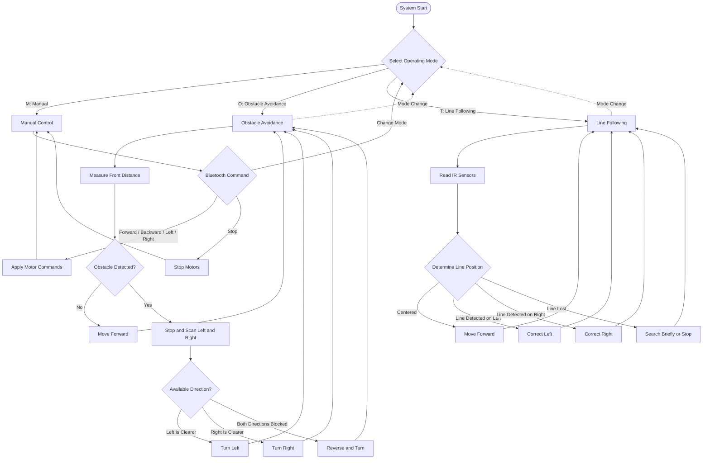

### 6.4 Bluetooth Command Interface

The HC-05 module receives commands from a smartphone or computer and transfers them to the Arduino through serial communication.
Command	Function
M	Activate manual mode
O	Activate obstacle avoidance mode
T	Activate line-following mode
F	Move forward
B	Move backward
L	Turn left
R	Turn right
S	Stop manual movement
+	Increase motor speed
-	Decrease motor speed

Note: Commands are interpreted according to the firmware implementation. Test the command mapping and stopping behavior before operating the robot.

7. Complete Arduino Firmware
The following is a complete reference implementation for the hardware configuration and pin map described in this report. It includes all three modes, Bluetooth commands, motor-speed adjustment, line tracking, ultrasonic measurement, and servo-assisted obstacle scanning.

Before uploading: confirm the motor wiring, IR sensor polarity, servo orientation, Bluetooth logic levels, and power arrangement. The program has not been verified on your physical robot, so compile it in the Arduino IDE and test with the wheels raised before operating it on the floor.

#include <SoftwareSerial.h>
#include <Servo.h>

// ============================================================
// MULTI-MODE AUTONOMOUS SMART ROBOT CAR
// Board: Arduino Uno R3
// Driver: L298N
//
// Bluetooth modes:
//   M = Manual mode
//   O = Obstacle-avoidance mode
//   T = Line-tracking mode
//
// Manual movement commands:
//   F = Forward
//   B = Backward
//   L = Pivot left
//   R = Pivot right
//   S = Stop and return to manual mode
//   + = Increase manual speed
//   - = Decrease manual speed
// ============================================================

// -------------------- BLUETOOTH ------------------------------

const uint8_t BT_RX_PIN = 2;  // Arduino RX  <- HC-05 TX
const uint8_t BT_TX_PIN = 3;  // Arduino TX  -> divider -> HC-05 RX

SoftwareSerial bluetooth(BT_RX_PIN, BT_TX_PIN);

// -------------------- MOTOR DRIVER ---------------------------

// Left motor group
const uint8_t LEFT_PWM = 5;   // L298N ENA
const uint8_t LEFT_IN1 = 7;   // L298N IN1
const uint8_t LEFT_IN2 = 8;   // L298N IN2

// Right motor group
const uint8_t RIGHT_PWM = 6;  // L298N ENB
const uint8_t RIGHT_IN1 = 10; // L298N IN3
const uint8_t RIGHT_IN2 = 11; // L298N IN4

// -------------------- ULTRASONIC SENSOR ----------------------

const uint8_t TRIG_PIN = A0;
const uint8_t ECHO_PIN = A1;

const unsigned long SONAR_INTERVAL_MS = 65UL;
const unsigned long SONAR_TIMEOUT_US = 25000UL;

const float MAX_DISTANCE_CM = 400.0f;

float distanceCm = MAX_DISTANCE_CM;

enum SonarPhase {
  SONAR_IDLE,
  SONAR_LOW_WAIT,
  SONAR_TRIGGER_HIGH,
  SONAR_WAIT_ECHO_RISE,
  SONAR_WAIT_ECHO_FALL
};

SonarPhase sonarPhase = SONAR_IDLE;

unsigned long sonarPhaseStartedUs = 0;
unsigned long echoRiseUs = 0;
unsigned long lastSonarTriggerMs = 0;
unsigned long sonarSequence = 0;

// -------------------- SERVO ----------------------------------

const uint8_t SERVO_PIN = 12;

const int SERVO_LEFT_ANGLE = 150;
const int SERVO_CENTER_ANGLE = 90;
const int SERVO_RIGHT_ANGLE = 30;

Servo ultrasonicServo;

// -------------------- IR LINE SENSORS ------------------------

const uint8_t IR_LEFT_PIN = A2;
const uint8_t IR_CENTER_PIN = A3;
const uint8_t IR_RIGHT_PIN = A4;

// Change to HIGH if your modules output HIGH on the line.
const uint8_t LINE_ACTIVE_LEVEL = LOW;

// -------------------- CONTROL SETTINGS -----------------------

const int MIN_MANUAL_SPEED = 90;
const int MAX_MANUAL_SPEED = 220;

int manualSpeed = 160;

const int AUTO_SPEED = 145;
const int LINE_SPEED = 125;
const int LINE_SEARCH_SPEED = 90;

const float SAFE_DISTANCE_CM = 25.0f;

const unsigned long SERVO_SETTLE_MS = 250UL;
const unsigned long REVERSE_TIME_MS = 320UL;
const unsigned long TURN_TIME_MS = 500UL;
const unsigned long LINE_LOST_SEARCH_MS = 350UL;

char manualMotion = 'S';

// -------------------- OPERATING MODES ------------------------

enum OperatingMode {
  MODE_MANUAL,
  MODE_OBSTACLE,
  MODE_LINE
};

OperatingMode currentMode = MODE_MANUAL;

// -------------------- OBSTACLE STATE MACHINE -----------------

enum AvoidState {
  OA_CRUISE,
  OA_LEFT_SETTLE,
  OA_LEFT_WAIT,
  OA_RIGHT_SETTLE,
  OA_RIGHT_WAIT,
  OA_CENTER_SETTLE,
  OA_CENTER_WAIT,
  OA_REVERSE,
  OA_TURN
};

AvoidState avoidState = OA_CRUISE;

unsigned long avoidStateStartedMs = 0;
unsigned long sonarSequenceAtStage = 0;

float leftDistanceCm = MAX_DISTANCE_CM;
float rightDistanceCm = MAX_DISTANCE_CM;
float centerDistanceCm = MAX_DISTANCE_CM;

// -1 means pivot left; +1 means pivot right.
int turnDirection = 1;

// -------------------- LINE TRACKING STATE --------------------

unsigned long lineLostSinceMs = 0;
bool lineLostTimerActive = false;

// -1 = last steering correction was left.
// +1 = last steering correction was right.
int lastSteerDirection = -1;

// ============================================================
// MOTOR CONTROL
// ============================================================

void setMotor(
  uint8_t pwmPin,
  uint8_t in1,
  uint8_t in2,
  int command
) {
  command = constrain(command, -255, 255);

  if (command > 0) {
    digitalWrite(in1, HIGH);
    digitalWrite(in2, LOW);
    analogWrite(pwmPin, command);
  }
  else if (command < 0) {
    digitalWrite(in1, LOW);
    digitalWrite(in2, HIGH);
    analogWrite(pwmPin, -command);
  }
  else {
    analogWrite(pwmPin, 0);
    digitalWrite(in1, LOW);
    digitalWrite(in2, LOW);
  }
}

void setDrive(int leftCommand, int rightCommand) {
  setMotor(
    LEFT_PWM, LEFT_IN1, LEFT_IN2, leftCommand
  );

  setMotor(
    RIGHT_PWM, RIGHT_IN1, RIGHT_IN2, rightCommand
  );
}

void stopMotors() {
  setDrive(0, 0);
}

void driveForward(int speedValue) {
  setDrive(speedValue, speedValue);
}

void driveBackward(int speedValue) {
  setDrive(-speedValue, -speedValue);
}

void turnLeft(int speedValue) {
  setDrive(-speedValue, speedValue);
}

void turnRight(int speedValue) {
  setDrive(speedValue, -speedValue);
}

// ============================================================
// ULTRASONIC SENSOR STATE MACHINE
// ============================================================

void completeSonarMeasurement(float measuredCm) {
  if (measuredCm <= 0.0f || measuredCm > MAX_DISTANCE_CM) {
    measuredCm = MAX_DISTANCE_CM;
  }

  // Keep very short non-zero readings conservative.
  if (measuredCm < 2.0f) {
    measuredCm = 2.0f;
  }

  distanceCm = measuredCm;
  sonarSequence++;
  sonarPhase = SONAR_IDLE;
}

void updateSonar() {
  const unsigned long nowUs = micros();

  switch (sonarPhase) {

    case SONAR_IDLE:
      if (millis() - lastSonarTriggerMs >= SONAR_INTERVAL_MS) {
        digitalWrite(TRIG_PIN, LOW);

        sonarPhase = SONAR_LOW_WAIT;
        sonarPhaseStartedUs = nowUs;
        lastSonarTriggerMs = millis();
      }
      break;

    case SONAR_LOW_WAIT:
      if (nowUs - sonarPhaseStartedUs >= 2UL) {
        digitalWrite(TRIG_PIN, HIGH);

        sonarPhase = SONAR_TRIGGER_HIGH;
        sonarPhaseStartedUs = nowUs;
      }
      break;

    case SONAR_TRIGGER_HIGH:
      if (nowUs - sonarPhaseStartedUs >= 10UL) {
        digitalWrite(TRIG_PIN, LOW);

        sonarPhase = SONAR_WAIT_ECHO_RISE;
        sonarPhaseStartedUs = nowUs;
      }
      break;

    case SONAR_WAIT_ECHO_RISE:
      if (digitalRead(ECHO_PIN) == HIGH) {
        echoRiseUs = nowUs;
        sonarPhase = SONAR_WAIT_ECHO_FALL;
      }
      else if (nowUs - sonarPhaseStartedUs >= SONAR_TIMEOUT_US) {
        // No echo detected within the allowed measurement time.
        // This implementation treats it as no obstacle in range.
        completeSonarMeasurement(MAX_DISTANCE_CM);
      }
      break;

    case SONAR_WAIT_ECHO_FALL:
      if (digitalRead(ECHO_PIN) == LOW) {
        const unsigned long echoDurationUs = nowUs - echoRiseUs;

        const float measuredCm =
          (echoDurationUs * 0.0343f) / 2.0f;

        completeSonarMeasurement(measuredCm);
      }
      else if (nowUs - echoRiseUs >= SONAR_TIMEOUT_US) {
        completeSonarMeasurement(MAX_DISTANCE_CM);
      }
      break;
  }
}

// ============================================================
// MODE CONTROL
// ============================================================

void resetObstacleController() {
  ultrasonicServo.write(SERVO_CENTER_ANGLE);

  avoidState = OA_CRUISE;
  avoidStateStartedMs = millis();

  leftDistanceCm = MAX_DISTANCE_CM;
  rightDistanceCm = MAX_DISTANCE_CM;
  centerDistanceCm = MAX_DISTANCE_CM;

  turnDirection = 1;
}

void selectMode(OperatingMode newMode) {
  stopMotors();

  currentMode = newMode;
  manualMotion = 'S';

  lineLostTimerActive = false;

  // Return the ultrasonic sensor to its forward position.
  ultrasonicServo.write(SERVO_CENTER_ANGLE);

  if (currentMode == MODE_MANUAL) {
    bluetooth.println(F("MODE: MANUAL"));
  }
  else if (currentMode == MODE_OBSTACLE) {
    resetObstacleController();
    bluetooth.println(F("MODE: OBSTACLE AVOIDANCE"));
  }
  else if (currentMode == MODE_LINE) {
    bluetooth.println(F("MODE: LINE TRACKING"));
  }
}

// ============================================================
// MANUAL CONTROL
// ============================================================

void applyManualMotion() {
  switch (manualMotion) {

    case 'F':
      driveForward(manualSpeed);
      break;

    case 'B':
      driveBackward(manualSpeed);
      break;

    case 'L':
      turnLeft(manualSpeed);
      break;

    case 'R':
      turnRight(manualSpeed);
      break;

    default:
      stopMotors();
      break;
  }
}

void handleBluetoothCommand(char command) {
  // Accept lowercase and uppercase commands.
  if (command >= 'a' && command <= 'z') {
    command = command - ('a' - 'A');
  }

  switch (command) {

    case 'M':
      selectMode(MODE_MANUAL);
      return;

    case 'O':
      selectMode(MODE_OBSTACLE);
      return;

    case 'T':
      selectMode(MODE_LINE);
      return;

    case 'S':
      // Global stop command: leave autonomous mode.
      selectMode(MODE_MANUAL);
      bluetooth.println(F("STOP COMMAND RECEIVED"));
      return;

    case '+':
      manualSpeed = constrain(
        manualSpeed + 15,
        MIN_MANUAL_SPEED,
        MAX_MANUAL_SPEED
      );

      if (currentMode == MODE_MANUAL) {
        applyManualMotion();
      }

      bluetooth.print(F("Manual speed: "));
      bluetooth.println(manualSpeed);
      return;

    case '-':
      manualSpeed = constrain(
        manualSpeed - 15,
        MIN_MANUAL_SPEED,
        MAX_MANUAL_SPEED
      );

      if (currentMode == MODE_MANUAL) {
        applyManualMotion();
      }

      bluetooth.print(F("Manual speed: "));
      bluetooth.println(manualSpeed);
      return;

    default:
      break;
  }

  // Movement commands only control motion in manual mode.
  if (currentMode == MODE_MANUAL) {
    if (command == 'F' || command == 'B' ||
        command == 'L' || command == 'R') {

      manualMotion = command;
      applyManualMotion();
    }
  }
}

// ============================================================
// OBSTACLE AVOIDANCE
// ============================================================

void beginObstacleScan(unsigned long nowMs) {
  stopMotors();

  ultrasonicServo.write(SERVO_LEFT_ANGLE);

  avoidState = OA_LEFT_SETTLE;
  avoidStateStartedMs = nowMs;
}

void runObstacleAvoidance() {
  const unsigned long nowMs = millis();

  switch (avoidState) {

    case OA_CRUISE:
      if (distanceCm < SAFE_DISTANCE_CM) {
        beginObstacleScan(nowMs);
      }
      else {
        driveForward(AUTO_SPEED);
      }
      break;

    case OA_LEFT_SETTLE:
      stopMotors();

      if (nowMs - avoidStateStartedMs >= SERVO_SETTLE_MS) {
        // Ignore any measurement made before the servo settled.
        sonarSequenceAtStage = sonarSequence;
        avoidState = OA_LEFT_WAIT;
        avoidStateStartedMs = nowMs;
      }
      break;

    case OA_LEFT_WAIT:
      stopMotors();

      if (sonarSequence > sonarSequenceAtStage) {
        leftDistanceCm = distanceCm;

        ultrasonicServo.write(SERVO_RIGHT_ANGLE);

        avoidState = OA_RIGHT_SETTLE;
        avoidStateStartedMs = nowMs;
      }
      break;

    case OA_RIGHT_SETTLE:
      stopMotors();

      if (nowMs - avoidStateStartedMs >= SERVO_SETTLE_MS) {
        sonarSequenceAtStage = sonarSequence;
        avoidState = OA_RIGHT_WAIT;
        avoidStateStartedMs = nowMs;
      }
      break;

    case OA_RIGHT_WAIT:
      stopMotors();

      if (sonarSequence > sonarSequenceAtStage) {
        rightDistanceCm = distanceCm;

        ultrasonicServo.write(SERVO_CENTER_ANGLE);

        avoidState = OA_CENTER_SETTLE;
        avoidStateStartedMs = nowMs;
      }
      break;

    case OA_CENTER_SETTLE:
      stopMotors();

      if (nowMs - avoidStateStartedMs >= SERVO_SETTLE_MS) {
        sonarSequenceAtStage = sonarSequence;
        avoidState = OA_CENTER_WAIT;
        avoidStateStartedMs = nowMs;
      }
      break;

    case OA_CENTER_WAIT:
      stopMotors();

      if (sonarSequence > sonarSequenceAtStage) {
        centerDistanceCm = distanceCm;

        // The center path is clear again.
        if (centerDistanceCm >= SAFE_DISTANCE_CM) {
          avoidState = OA_CRUISE;
          avoidStateStartedMs = nowMs;
          break;
        }

        // Choose the side with the larger measured clearance.
        turnDirection =
          (leftDistanceCm >= rightDistanceCm) ? -1 : 1;

        if (leftDistanceCm < SAFE_DISTANCE_CM &&
            rightDistanceCm < SAFE_DISTANCE_CM) {

          avoidState = OA_REVERSE;
          avoidStateStartedMs = nowMs;
        }
        else {
          avoidState = OA_TURN;
          avoidStateStartedMs = nowMs;
        }
      }
      break;

    case OA_REVERSE:
      driveBackward(120);

      if (nowMs - avoidStateStartedMs >= REVERSE_TIME_MS) {
        stopMotors();

        avoidState = OA_TURN;
        avoidStateStartedMs = nowMs;
      }
      break;

    case OA_TURN:
      if (nowMs - avoidStateStartedMs < TURN_TIME_MS) {
        if (turnDirection < 0) {
          turnLeft(140);
        }
        else {
          turnRight(140);
        }
      }
      else {
        stopMotors();

        ultrasonicServo.write(SERVO_CENTER_ANGLE);

        avoidState = OA_CRUISE;
        avoidStateStartedMs = nowMs;
      }
      break;
  }
}

// ============================================================
// LINE FOLLOWING
// ============================================================

void runLineFollower() {
  const bool leftOnLine =
    digitalRead(IR_LEFT_PIN) == LINE_ACTIVE_LEVEL;

  const bool centerOnLine =
    digitalRead(IR_CENTER_PIN) == LINE_ACTIVE_LEVEL;

  const bool rightOnLine =
    digitalRead(IR_RIGHT_PIN) == LINE_ACTIVE_LEVEL;

  // Any active sensor indicates that some part of the line
  // is currently visible.
  if (leftOnLine || centerOnLine || rightOnLine) {
    lineLostTimerActive = false;
  }

  // Both outside sensors active: likely a crossing or a wide line.
  if (leftOnLine && rightOnLine) {
    setDrive(105, 105);
  }

  // Line is toward the left.
  else if (leftOnLine && centerOnLine) {
    lastSteerDirection = -1;
    setDrive(85, LINE_SPEED);
  }

  // Line is toward the right.
  else if (rightOnLine && centerOnLine) {
    lastSteerDirection = 1;
    setDrive(LINE_SPEED, 85);
  }

  // Line approximately centered.
  else if (centerOnLine) {
    driveForward(LINE_SPEED);
  }

  // Only the left sensor detects the line.
  else if (leftOnLine) {
    lastSteerDirection = -1;
    turnLeft(LINE_SEARCH_SPEED);
  }

  // Only the right sensor detects the line.
  else if (rightOnLine) {
    lastSteerDirection = 1;
    turnRight(LINE_SEARCH_SPEED);
  }

  // All sensors report no line: briefly search in the
  // direction of the last correction, then stop.
  else {
    const unsigned long nowMs = millis();

    if (!lineLostTimerActive) {
      lineLostSinceMs = nowMs;
      lineLostTimerActive = true;
    }

    if (nowMs - lineLostSinceMs < LINE_LOST_SEARCH_MS) {
      if (lastSteerDirection < 0) {
        turnLeft(LINE_SEARCH_SPEED);
      }
      else {
        turnRight(LINE_SEARCH_SPEED);
      }
    }
    else {
      stopMotors();
    }
  }
}

// ============================================================
// SETUP
// ============================================================

void setup() {
  Serial.begin(115200);

  bluetooth.begin(9600);

  // Motor driver pins
  pinMode(LEFT_PWM, OUTPUT);
  pinMode(LEFT_IN1, OUTPUT);
  pinMode(LEFT_IN2, OUTPUT);

  pinMode(RIGHT_PWM, OUTPUT);
  pinMode(RIGHT_IN1, OUTPUT);
  pinMode(RIGHT_IN2, OUTPUT);

  // Ultrasonic pins
  pinMode(TRIG_PIN, OUTPUT);
  pinMode(ECHO_PIN, INPUT);

  digitalWrite(TRIG_PIN, LOW);

  // Digital IR sensor outputs
  pinMode(IR_LEFT_PIN, INPUT);
  pinMode(IR_CENTER_PIN, INPUT);
  pinMode(IR_RIGHT_PIN, INPUT);

  // Servo initialization
  ultrasonicServo.attach(SERVO_PIN);
  ultrasonicServo.write(SERVO_CENTER_ANGLE);

  stopMotors();

  resetObstacleController();

  currentMode = MODE_MANUAL;
  manualMotion = 'S';

  Serial.println(F("Multi-Mode Smart Robot Car"));
  Serial.println(F("Bluetooth commands: M, O, T, F, B, L, R, S, +, -"));

  bluetooth.println(F("SMART ROBOT READY"));
  bluetooth.println(F("M=Manual, O=Obstacle, T=Line"));
  bluetooth.println(F("F=Forward, B=Back, L=Left, R=Right"));
  bluetooth.println(F("S=Stop, +=Faster, -=Slower"));
}

// ============================================================
// MAIN LOOP
// ============================================================

void loop() {
  // Update the distance measurement without using pulseIn().
  updateSonar();

  // Process all commands currently available.
  while (bluetooth.available() > 0) {
    const char incoming = (char)bluetooth.read();
    handleBluetoothCommand(incoming);
  }

  // Execute exactly one primary operating mode.
  switch (currentMode) {

    case MODE_MANUAL:
      // Manual motion is applied when its command is received.
      break;

    case MODE_OBSTACLE:
      runObstacleAvoidance();
      break;

    case MODE_LINE:
      runLineFollower();
      break;
  }
}

7.1 Important Notes About the Firmware
The source code implements the intended reference design, but a few technical limitations should be understood before claiming successful hardware performance.

Ultrasonic timeout behavior: In the current implementation, a timeout is interpreted as no detected obstacle within range. A timeout can also occur when the sensor is disconnected, misaligned, or unable to detect a particular target. For a more conservative design, repeated timeouts or suspected sensor faults should trigger a stop rather than allowing continued autonomous movement.

Servo scanning: The scan routine waits for each servo position to settle and then waits for a new ultrasonic measurement. The settling interval may need adjustment for the particular servo, sensor mount, and supply voltage.

Line polarity: Change LINE_ACTIVE_LEVEL to HIGH if the actual sensors use the opposite output polarity.

Motor polarity and steering: If a forward command makes the robot rotate, check the motor connections and identify the left and right motor groups. If a line correction turns the robot away from the line, the sensor ordering, motor wiring, or correction logic may be reversed.

Stop behavior: The software's stop command disables motor drive, but it is not a safety-rated emergency-stop system. The robot may coast, and a wireless connection may fail to deliver a command in time. Physical power isolation remains important.

8. Bluetooth Application and Command Interface
8.1 Command Table
The Bluetooth application should send individual characters to the HC-05.
Command	Function
M	Enter manual mode
O	Enter obstacle-avoidance mode
T	Enter line-tracking mode
F	Move forward in manual mode
B	Move backward in manual mode
L	Pivot left in manual mode
R	Pivot right in manual mode
S	Stop motor drive and return to manual mode
+	Increase the manual speed setting
-	Decrease the manual speed setting

The letter T is used to select line-tracking mode so that it does not conflict with the L command for a manual left turn.
8.2 Example Operating Procedure
1. Power the robot and connect the Bluetooth application to the HC-05.
2. Send M and test each manual movement command with the wheels raised.
3. Send S to stop the motors.
4. Place the robot on a suitable flat surface with clear space ahead.
5. Send O to activate obstacle avoidance.
6. Place a suitable object ahead of the sensor and verify that the robot stops and scans.
7. Send S, position the vehicle above a marked line, and then send T.
8. Observe its movement and adjust sensor height, speed, and active-level configuration as necessary.
Bluetooth pairing and application behavior depend on the phone or computer operating system. The project uses classic Bluetooth serial communication through the HC-05 and should not be assumed to work directly with every Bluetooth Low Energy-only application.
